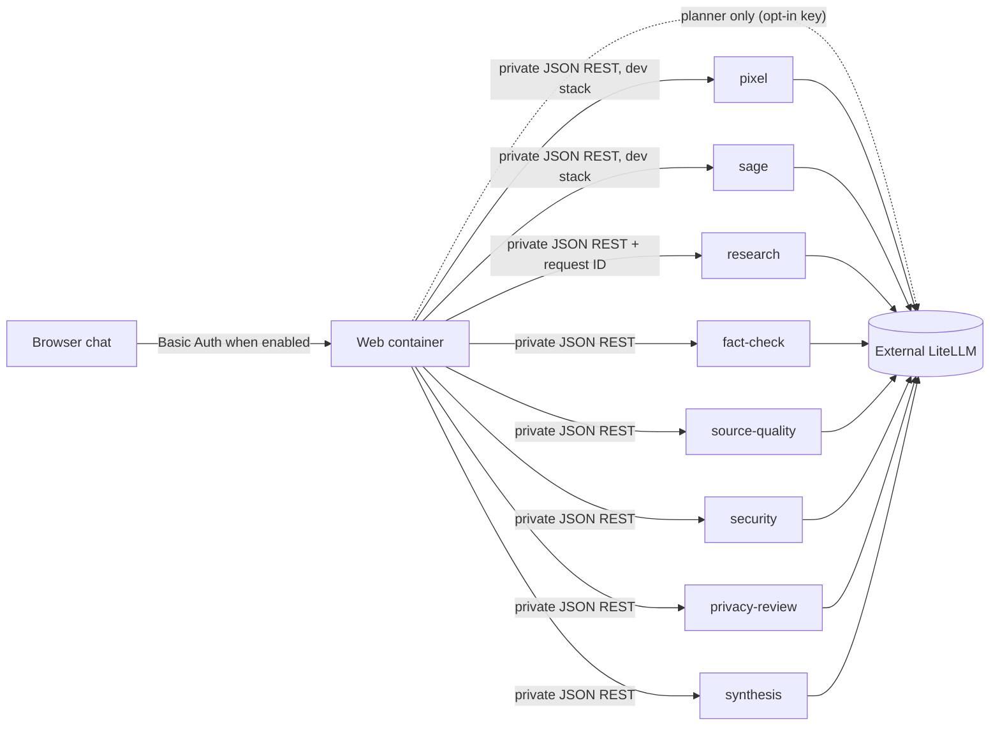

# ViharBot

[](https://github.com/vchokshi/viharbot/actions/workflows/ci.yml?query=branch%3Amain)
[](https://github.com/vchokshi/viharbot/actions/workflows/ci.yml?query=branch%3Amain)
[](https://github.com/vchokshi/viharbot/actions/workflows/ci.yml?query=branch%3Amain)
[](https://github.com/vchokshi/viharbot/actions/workflows/ci.yml?query=branch%3Amain)
[](https://github.com/vchokshi/viharbot/actions/workflows/ci.yml?query=branch%3Amain)

[](https://github.com/vchokshi/viharbot/security/code-scanning)
[](https://github.com/vchokshi/viharbot/actions/workflows/dependency-review.yml)
[](https://github.com/vchokshi/viharbot/actions/workflows/security.yml?query=branch%3Amain)

ViharBot is an experimental multi-agent AI laboratory with a browser chat as one of its interfaces. A FastAPI web container coordinates eight independently deployed FastAPI agent services (six core services plus Pixel and Sage) over private JSON REST. A named coordinator, Charlie Chatwin, can plan the work one step at a time, but the application, not the model, decides what may run. All model inference goes through Strands Agents to an externally managed [LiteLLM](docs/litellm-integration.md) proxy; there are no direct provider calls.

This README describes what the code on `main` does today. Planned work is labelled as planned. See [development status](docs/development-status.md) for what is implemented, tested, integrated, deployed and operationally validated, and the [Phase 6.5 audit](docs/audits/phase-6.5-architecture-audit.md) for the evidence behind these statements.

## Start here (new developers)

**What this is.** A laboratory for experimenting with how specialised AI agents collaborate. The browser chat is one interface; the backend does not depend on it. Possible commercial applications (for example security consulting) are future work and must not be built into the core.

**Where the real logic is.** Read in this order:

1. `src/viharbot/orchestration_policy.py`: what may run and in what order (a model only proposes). Then `iterative_execution.py` (the loop), `orchestration_state.py` (versioned results) and `orchestration_planner.py` (Charlie's one-step planner).
2. `src/viharbot/identity.py`, `execution_bindings.py` and `execution_config/bindings.toml`: identity (who), capability (what), binding (which service runs it). Placement (where it runs) is configured separately by URL; see below.
3. `src/viharbot/model_agent.py`: the single place a model is called, always through LiteLLM.
4. `research_agent.py`, `security_agent.py`, `specialist_agent.py`, `pixel_agent.py`, `sage_agent.py`: the agent services. `web_app.py`: HTTP entry points and the UI.
5. `live_events.py` and `live_stream.py`: the typed event stream. The canonical protocol is in [live observability](docs/live-observability.md).

**Things that will surprise you.**

* An identity is a persona and a routing label. By default it does not change behavior (`VIHARBOT_PERSONALITY_INFERENCE_ENABLED` and `VIHARBOT_PERSONA_PROMPT_ENABLED` are set nowhere). Adding an *operational* agent means editing about ten places (the `Capability` enum and several tables in `identity.py`, `execution_bindings.py`, `orchestration_state.py` and `orchestration_policy.py`, the response model, `web_app.agent_urls()`, compose and the Stage spec). Fixes are planned: [#226](https://github.com/vchokshi/viharbot/issues/226) (placement file) and [#227](https://github.com/vchokshi/viharbot/issues/227) (capability manifest, deferred).
* The Research agent (Nova) makes one model call from the model's own knowledge. It has no retrieval tool, so Fact Check judges only the evidence Nova supplied ([#237](https://github.com/vchokshi/viharbot/issues/237)).
* Memory is write-only JSONL: written, never read, no retention ([#229](https://github.com/vchokshi/viharbot/issues/229)).
* `demo.py` holds core pipeline functions as well as the CLI demo ([#232](https://github.com/vchokshi/viharbot/issues/232)).
* Which mode `/api/chat` runs depends on whether the web container has a planner alias and a LiteLLM key ([#223](https://github.com/vchokshi/viharbot/issues/223)).
* `identity_execution.py` and `delegated_execution.py` are not reachable from the web app ([#222](https://github.com/vchokshi/viharbot/issues/222)).

**Working agreements.** Read [AGENTS.md](AGENTS.md) and [CONTRIBUTING.md](CONTRIBUTING.md) first. Every issue and PR needs a WHY. A push to `main` deploys nothing; promotion to Stage needs the founder's explicit approval. Model inference goes through the external LiteLLM gateway, which this repository does not deploy or manage. The one exception is Kepler, which may use allowlisted non-Anthropic Bedrock models ([ADR-011](docs/adr/ADR-011-kepler-inference-exception.md)); no Kepler code calls a model yet. Governance expansion (new governance documents, ADRs, skills-registry entries and governance automation) is paused ([#238](https://github.com/vchokshi/viharbot/issues/238)); existing controls such as the CLA gate remain active.

**Current direction (founder decisions, 2026-11-06).** Identities stay rich and services few. Kepler is the first agent for AWS AgentCore ([#198](https://github.com/vchokshi/viharbot/issues/198)); its AWS foundation exists, the agent does not yet. Dev-stack flags are being removed ([#225](https://github.com/vchokshi/viharbot/issues/225)). A single placement file comes before any capability manifest. Agent memory stays write-only with a retention guardrail ([#229](https://github.com/vchokshi/viharbot/issues/229)). Authentication between agents is not required on Stage yet ([#235](https://github.com/vchokshi/viharbot/issues/235)). Run records, a lockfile, cost logging and a versioned run API are planned ([#228](https://github.com/vchokshi/viharbot/issues/228), [#230](https://github.com/vchokshi/viharbot/issues/230), [#231](https://github.com/vchokshi/viharbot/issues/231), [#233](https://github.com/vchokshi/viharbot/issues/233)). The full list of open work is on the [issue tracker](https://github.com/vchokshi/viharbot/issues).

**First day.** Copy `.env.example` to `.env`, run `docker compose up --build -d`, open `http://127.0.0.1:8080`, then run the tests as described under [Tests](#tests). Ask the founder for a LiteLLM key; never commit one.

## Architecture



The web container serves the UI and runs the orchestration. It is model-backed only for Charlie's planner, and only when iterative orchestration is enabled and a planner alias and key are supplied. Locally, Compose publishes only the web port, on `127.0.0.1:8080`; the eight agents stay on the private Compose network. See [architecture](docs/architecture.md) for the full picture.

## Agents and capabilities

Eleven agent identities are defined (the original eight, the education agents Archie and Ada, and Kepler); six are connected to running services (Nova, Scout, Cipher and Charlie, plus Pixel and Sage in the dev stack). Atlas, Orbit, Archie, Ada and Kepler have no execution binding. Kepler is being built as a first-contributor steward on AWS AgentCore ([#198](https://github.com/vchokshi/viharbot/issues/198), [design](docs/kepler-steward-aws.md)): a read-only assessment core exists in `src/viharbot/steward/` and the AWS lab foundation is provisioned ([change record](docs/aws-lab-change-record.md)), but the agent is not deployed and nothing in orchestration calls it.

| Identity | Status | Capability | Service | Default model alias |
|---|---|---|---|---|
| Nova | live | research | `research` | `gpt-6.1-sol` |
| Scout | live | fact check | `fact-check` | `gemini/gemini-3.5-flash` |
| Scout | live | source quality | `source-quality` | `gemini/gemini-3.5-flash` |
| Cipher | live | security assessment | `security` | `openai/gpt-5.4` |
| Cipher | live | privacy review | `privacy-review` | `openai/gpt-5.4-mini` |
| Charlie | live | synthesis | `synthesis` | `openai/gpt-5.4-mini` |
| Charlie | live (opt-in) | planning | in the web container | `gpt-6-luna` (`CHARLIE_PLANNER_MODEL`) |
| Atlas | planned | none connected | none | none |
| Sage | live in the dev stack; Charlie may delegate it ([Sage service](docs/sage-service.md)) | philosophical analysis | `sage`, bound | `gpt-6.1-sol` in Compose |
| Pixel | live, on request (flag) | slide generation | `pixel` | `openai/gpt-5.4-mini` |
| Orbit | support role, not connected | none connected | none | none |

Fact Check reviews only the evidence Research supplied; it does not browse. Each non-trivial verdict must quote that evidence, and the application checks the quote. Source Quality inspects reference strings without fetching them.

## Skills registry (proposed architecture)

A declarative registry of 98 skills across eleven identities (the original eight, the education agents Archie and Ada, see [Education agents](docs/education-agents.md), and the proposed coding agent Kepler, see [Kepler](docs/kepler.md), which has no skills yet) lives in `src/viharbot/skills/`. It is **metadata only**: every skill is `proposed`, none can execute, and nothing in the running application reads it. An identity says who an agent is; a skill says what professional work it could do; a capability says what it is suited to do and whether a service exists; an execution binding says which service runs it. Only bindings run anything. See [Skills registry](docs/skills-registry.md) for how to add and validate a skill and how skills would later be authorized, and the governance documents: [Founding Charter v2](docs/governance/founding-charter-v2.md), [Agent Constitution v1](docs/governance/agent-constitution-v1.md), [Agent Architecture v1.1](docs/governance/agent-architecture-v1.1.md) and [Skills Registry v1](docs/governance/agent-skills-registry-v1.md). These documents are proposed, not implemented, except where the repository says otherwise.

## Execution modes

`POST /api/chat` picks the first mode whose flags allow it (`web_app.py`):

| Mode | Flags | Behavior |
|---|---|---|
| Slide decks (Pixel) | `VIHARBOT_PPT_GENERATION_ENABLED` (true in local Compose while testing; set it false when the feature is done) | After the pipeline, if the message asks for a deck, the pixel service plans and builds a `.pptx`; see [Pixel slide service](docs/pixel-slide-service.md) |
| Live team conversation (iterative orchestration) | **No flag.** It runs when Charlie's planner is configured: a planner alias (`gpt-6-luna` by default) and `WEB_LITELLM_API_KEY` passed to the web container. Without the key the web service runs the fixed pipeline | Charlie recommends one step at a time; policy authorizes it; the loop runs it, and Pixel joins when you ask for a deck |
| Fixed pipeline | none (the default) | Research, then the specialists in a fixed order |

The older identity-routing and delegation flags no longer exist; their modules are not reachable from the web app ([#222](https://github.com/vchokshi/viharbot/issues/222)). The flags that remain are `VIHARBOT_PPT_GENERATION_ENABLED` (true in Compose, false on Stage), `VIHARBOT_PERSONALITY_INFERENCE_ENABLED` and `VIHARBOT_PERSONA_PROMPT_ENABLED` (both set nowhere) and `VIHARBOT_DEV_DIAGNOSTICS_ENABLED` (false). All are scheduled for removal from the dev stack ([#225](https://github.com/vchokshi/viharbot/issues/225)). `POST /api/chat/stream` (live events) works only in iterative mode and returns `409` otherwise. Details: [iterative orchestration](docs/iterative-orchestration.md), [controlled delegation](docs/controlled-delegation.md), [identity execution](docs/identity-execution-integration.md).

## Charlie's orchestration

Each decision is a fresh, stateless planner call that can only propose `delegate <capability>` or `finish`. The application enforces dependencies (Research first; Security needs Research; Privacy Review and Synthesis need Research and Security), freshness of versioned results, budgets (8 decisions, 6 executions, 2 repeats, 240 seconds, 2 refused actions by default) and an absolute request deadline. A recommendation is never an authorization.

## Live observability

With iterative mode on, the page streams real events as they happen: Charlie's planning, delegations, each agent starting and finishing, dependencies, superseded evidence and the final answer. It shows them as a chat between Charlie and the specialists, with the model for each speaker when the service reported it (requires `VIHARBOT_DEV_DIAGNOSTICS_ENABLED`). The chat wording is templated from recorded events, not generated by the agents' models. The protocol is documented in [live observability](docs/live-observability.md).

## Models and credentials

Every model call goes through `build_agent()` (`src/viharbot/model_agent.py`), which builds a Strands `LiteLLMModel` pointed at LiteLLM. Each agent container gets its own alias and `LITELLM_API_KEY`. The web container receives a key only if you opt in with `WEB_LITELLM_API_KEY` (needed for Charlie's planner). `LITELLM_BASE_URL` defaults to `https://litellm.viharchokshi.com`. A configured alias does not prove it works: confirm each alias is available to your LiteLLM account first (see [LiteLLM integration](docs/litellm-integration.md)). ViharBot does not deploy or modify LiteLLM. Never commit `.env`.

## Run locally

```bash
cp .env.example .env     # set LITELLM_API_KEY and aliases your account can use
docker compose up --build -d
```

Open [http://127.0.0.1:8080](http://127.0.0.1:8080). Local Basic Auth is off by default because the listener is bound to loopback; set `WEB_AUTH_ENABLED=1`, `WEB_USERNAME` and `WEB_PASSWORD` to try it. To turn on live orchestration, add the three flags, `CHARLIE_PLANNER_MODEL` and `WEB_LITELLM_API_KEY` to `.env` (this makes billable calls). A CLI-style run: `docker compose --profile demo run --build --rm orchestrator`. Stop with `docker compose down`.

## Tests

The default suite mocks all model and LiteLLM calls and is the authoritative one. Run it on the host with Node installed (the UI tests run the page's real script in a fake DOM):

```bash
python -m pytest -q
```

Two environment notes. LiteLLM loads a `.env` it finds above its install location when it is imported, which used to flip feature flags on and fail tests on the host. The test configuration (`tests/conftest.py`) now sets `LITELLM_MODE=PRODUCTION` before that import, so a local `.env` no longer affects the offline suite and there is no need to move it aside. This applies to tests only; the application is unchanged. It is skipped when you opt in to the live checks from the shell (`RUN_LITELLM_INTEGRATION=1` or `RUN_LITELLM_INFERENCE=1`), which may need a key kept in `.env`, and you can set `LITELLM_MODE=DEV` yourself to load it on purpose. The Docker profile runs the same offline suite in a container:

```bash
docker compose --profile tests run --build --rm tests
```

The test image (`Dockerfile.tests`) adds Node 24 and `git`, and its build context is an allowlist (`Dockerfile.tests.dockerignore`), so a local `.env`, credentials and `.git` never enter it. The `tests` service takes no values from your shell or `.env`, keeps the opt-in live checks off and has no network at run time, so it cannot make a model call. The image is for tests only; the production images contain neither pytest nor Node. A skipped test is not a pass: without Node the UI tests skip, and CI fails on any skip other than the opt-in live checks. Opt-in live checks (`RUN_LITELLM_INTEGRATION`, `RUN_LITELLM_INFERENCE`) and `scripts/fact_check_eval/run.py` make billable calls and are off by default.

## Development Wiki

The top bar's **Development Wiki** (`#wiki`) shows epic progress, a timeline and the repository's own documentation, read from GitHub. It is read-only, makes no model calls and needs `DEV_WIKI_GITHUB_TOKEN` (empty means "unavailable"). Percentages are derived from linked child issues and shown with their method; where nothing is linked they read *unknown*. See [Development Wiki](docs/development-wiki.md).

## Quality checks

Every pull request and every push to `main` runs [GitHub Actions](https://github.com/vchokshi/viharbot/actions): Python tests on 3.12 and 3.13 with coverage, frontend tests on Node 24, Ruff, and a Docker build with a health smoke test (on pull requests only when a container definition or `src/` changes; always on `main`). CodeQL, dependency review and four security scanners run separately. The badges above come from those runs; none is hand-maintained. A green badge says the check ran and passed against the latest run on `main`. It does not prove the code has no bugs or vulnerabilities, and a badge can show an older successful run until the next one finishes.

Test results, coverage (XML and HTML) and scan reports are uploaded as artifacts on each run. Code scanning findings are under [Security](https://github.com/vchokshi/viharbot/security/code-scanning). The same checks locally:

```bash
python -m pip install -e ".[test]" ruff==0.17.3
python -m pytest --cov              # also needs Node for the UI tests; a local .env is ignored
ruff check src tests scripts .github/scripts
```

Details, thresholds, required repository settings and known limits: [continuous integration](docs/continuous-integration.md).

## Deployment

Pushing to `main` updates source only; nothing deploys automatically.

| Target | State |
|---|---|
| Local Docker Compose | The development environment (nine services: web plus eight agents, and `orchestrator` and `tests` profiles) |
| DigitalOcean App Platform | A template exists in [`deploy/digitalocean/app.yaml`](deploy/digitalocean/app.yaml) (seven components: web plus six agents; no Pixel or Sage, so it is behind the dev stack; `deploy_on_push: false`). The committed spec sets no planner alias or key, so a Stage built from it runs the fixed pipeline and `/api/chat/stream` answers `409` |
| AWS / Bedrock AgentCore | Compatibility code and notes ([AgentCore notes](deploy/agentcore/README.md)); no AgentCore runtime is deployed and the streaming route is not bridged. Separately, Kepler's AWS lab foundation (IAM, ECR, DynamoDB, SNS) is provisioned ([change record](docs/aws-lab-change-record.md)) |

## Security boundaries

* All web routes except `/health` use the same shared Basic Auth when enabled (`/`, `/images/*` when served locally, `/api/chat`, `/api/chat/stream`, `/api/development/*`); images loaded from `WEB_IMAGES_BASE_URL` are public and bypass it (docs/image-storage.md). It is not per-user identity.
* Agent services rely on the private network. The four specialist services can verify signed service assertions, but only when `VIHARBOT_SERVICE_AUTH` is set, and nothing sets it by default. Research, Security, Pixel and Sage verify nothing. Do not publish agent ports. Extending authentication is deferred for Stage ([#235](https://github.com/vchokshi/viharbot/issues/235)).
* The browser never receives an agent key. Logs hold agent, request ID, destination, alias, duration and error type, never prompts, findings or keys.
* Model output is untrusted: the page renders it with `textContent`, and Markdown answers produce no links or HTML.

## Known limitations

* Agent memory is append-only JSONL, written but never read back, and ephemeral on App Platform.
* Agent-to-agent REST is unauthenticated; identities do not have separate cloud permissions.
* Calls run one at a time, and cancelling a browser request does not stop work already in flight.
* Planned, not built: per-user accounts, durable sessions and memory, authenticated inter-agent calls, distributed runtimes, Atlas, Sage and Orbit. Pixel's slide decks are built only in local Compose and are unverified against a live model; see [Pixel slide service](docs/pixel-slide-service.md).

## Contributing and licensing

ViharBot is personally owned and intended to remain proprietary. Public visibility is not a licence, and no open-source licence has been granted. Anyone can fork and propose changes; merges are decided by the founder, and external code is not merged until a contribution agreement is approved (none exists yet). See [CONTRIBUTING.md](CONTRIBUTING.md) for both contributor paths, onboarding, AI use and architectural approval.

## Documentation

[Contributing](CONTRIBUTING.md) · [Architecture](docs/architecture.md) · [Continuous integration](docs/continuous-integration.md) · [Development status](docs/development-status.md) · [Development Wiki](docs/development-wiki.md) · [Phase 6.5 audit](docs/audits/phase-6.5-architecture-audit.md) · [Live observability protocol](docs/live-observability.md) · [Iterative orchestration](docs/iterative-orchestration.md) · [Controlled delegation](docs/controlled-delegation.md) · [Identity execution](docs/identity-execution-integration.md) · [Personality-aware inference](docs/personality-aware-inference.md) · [Agent identities](docs/agent-identity-architecture.md) · [Skills registry](docs/skills-registry.md) · [Governance](docs/governance/agent-architecture-v1.1.md) · [Agent communication](docs/agent-communication.md) · [LiteLLM](docs/litellm-integration.md) · [Deployment](docs/deployment-strategy.md) · [Identity and security](docs/identity-and-security.md) · [Memory](docs/memory-architecture.md) · [Observability](docs/observability.md) · [AgentCore](deploy/agentcore/README.md)
