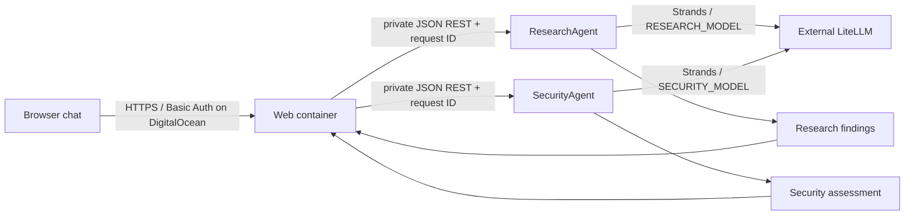

# ViharBot Phase 1

ViharBot is a web-first research and security chat app. A browser talks to a small FastAPI web container, which coordinates two independently deployed FastAPI agents using JSON REST. ResearchAgent returns structured findings; SecurityAgent reviews those findings and returns a structured assessment. Both use Strands Agents through the separately managed LiteLLM proxy. No direct provider calls are made.

## Architecture



The web service is the only public component in the DigitalOcean App Platform template. Research and Security are private internal services. Locally, Compose binds only the web UI to `127.0.0.1:8080`; agent ports stay on the private Compose network. The web app is a coordinator and UI, not a third model-backed agent.

The web page presents findings and the security assessment in a chat layout. It sends the last four user/assistant turns from the current browser tab as context with each message. The history is held in browser memory only, is not stored server-side, and disappears on reload. SecurityAgent receives the structured findings for the current request, not the browser conversation.

## Run locally

Copy `.env.example` to `.env`, then set `LITELLM_API_KEY` and LiteLLM aliases available to your account:

```bash
cp .env.example .env
docker compose up --build -d web
```

Open [http://127.0.0.1:8080](http://127.0.0.1:8080). Local Basic Auth is disabled by default because the listener is bound to loopback. To exercise local auth, set `WEB_AUTH_ENABLED=1`, `WEB_USERNAME`, and `WEB_PASSWORD` in `.env`, then recreate the web service.

To run the CLI-style pipeline without the web app:

```bash
docker compose --profile demo run --build --rm orchestrator
```

To stop the local containers:

```bash
docker compose down
```

## DigitalOcean App Platform

[`deploy/digitalocean/app.yaml`](deploy/digitalocean/app.yaml) defines the `viharbot-stage` app with three containers from this GitHub repository: a public web service and private Research and Security services. App Platform supports Dockerfile-backed components and internal service ports; see the [App Spec reference](https://docs.digitalocean.com/products/app-platform/reference/app-spec/) and [internal routing guide](https://docs.digitalocean.com/products/app-platform/how-to/manage-internal-routing/).

Before creating the app, connect DigitalOcean to GitHub and replace the empty secret values in the template through the DigitalOcean control panel with encrypted runtime secrets:

- Set `LITELLM_API_KEY` separately on Research and Security. The web component does not receive this key.
- Set `WEB_USERNAME` and `WEB_PASSWORD` on the web component. The template enables HTTP Basic Auth for `/` and `/api/chat`; `/health` remains open for platform health checks.
- Keep the two model aliases configured separately on their agent services.

Then review the spec and create the app using DigitalOcean's [App Platform CLI flow](https://docs.digitalocean.com/products/app-platform/how-to/create-apps/), for example `doctl apps propose --spec deploy/digitalocean/app.yaml` followed by `doctl apps create --spec deploy/digitalocean/app.yaml`. Creating the app provisions billable DigitalOcean resources; no resources have been created by this project setup.

The App Platform template writes agent memory under `/tmp`, which is ephemeral and can be lost when an instance is replaced. Local Compose instead bind-mounts separate `data/research` and `data/security` directories. This is an initial deployment layout, not production-grade persistent memory, multi-user identity, or authorization between users.

## Models and credentials

The provided aliases are `RESEARCH_MODEL=openai/gpt-5.4-mini` (reported tested) and `SECURITY_MODEL=openai/gpt-5.4` (must pass an actual inference check before the SecurityAgent is considered ready). `LITELLM_BASE_URL` defaults to `https://litellm.viharchokshi.com`. ViharBot does not deploy or modify LiteLLM.

Do not commit `.env` or put credentials in source. The API key is sent to LiteLLM over HTTPS and is not logged or passed to the web container. Agent-to-agent and web-to-agent calls use JSON over the private Compose/App Platform network.

## Tests

The default suite mocks model and LiteLLM calls. Run it in Docker with:

```bash
docker compose --profile tests run --build --rm tests
```

Optional live connectivity and inference checks are described in the [LiteLLM integration notes](docs/litellm-integration.md). They are disabled by default; inference checks can consume model quota.

## Project scope

Phase 1 implements ResearchAgent and SecurityAgent. The long-term design has six planned agents, but the other four are proposals, not implemented services. The current product target is a browser-based web app; a native or phone-specific client may be considered later. Independent agent permissions, per-user accounts, rate limiting, durable web sessions, and production-grade memory remain future work. No AWS resources or DigitalOcean resources are provisioned automatically.
