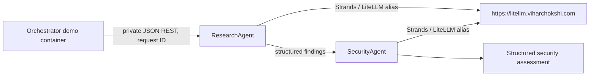

# ViharBot Phase 1

A Python 3.12 project with two independently containerized FastAPI agents. ResearchAgent returns structured findings; SecurityAgent evaluates them and returns a structured assessment. Both use Strands Agents SDK through the separately managed LiteLLM proxy. No direct provider calls are made.

## Flow



The orchestrator runs as a short-lived container on the private Compose network. No agent API ports are published to the host. LiteLLM is external and is neither deployed nor modified.

## Configure

Copy .env.example to .env and set the proxy key and two aliases that exist in LiteLLM:

```bash
cp .env.example .env
```

The provided aliases are RESEARCH_MODEL=openai/gpt-5.4-mini (reported tested) and SECURITY_MODEL=openai/gpt-5.4 (must pass an actual inference check before the SecurityAgent is considered ready). Set LITELLM_API_KEY in .env. LITELLM_BASE_URL defaults to https://litellm.viharchokshi.com. Do not commit .env; API keys are never logged.

## Verify the Security model first

The /v1/models catalog is not proof that inference works. After placing the proxy key in local .env, run this single test to send a non-sensitive structured inference request using exactly openai/gpt-5.4:

~~~bash
docker compose --profile tests run --build --rm -e RUN_LITELLM_INFERENCE=1 tests python -m pytest -q tests/test_phase1.py::test_live_security_inference
~~~

It must return HTTP 200 with a valid SecurityAssessment before using SecurityAgent in the end-to-end demo. This makes a real LiteLLM model call. The API key stays in .env and is passed to the test container as an environment variable.

## Run the flow

All agents run in containers; no agent process needs to run directly on your Mac.

```bash
docker compose up --build -d research security
docker compose --profile demo run --rm orchestrator
docker compose down
```

The orchestrator creates a request ID, calls ResearchAgent, then sends its JSON findings and the same ID to SecurityAgent. SecurityAgent makes a second model request through LiteLLM and returns its assessment.

## Tests

Default tests mock LiteLLM and do not require credentials or inference. Run them in Docker:

```bash
docker compose --profile tests run --build --rm tests
```

For a real, non-inference connectivity check, run the optional test after setting the HTTPS URL and key in .env:

```bash
docker compose --profile tests run --build --rm -e RUN_LITELLM_INTEGRATION=1 tests
```

This check calls only GET /v1/models; it does not generate a completion. After the Security alias has been verified, run the full end-to-end demo. To explicitly run both live inference tests, set RUN_LITELLM_INFERENCE=1 in .env and rerun the test container. Those calls use the configured LiteLLM aliases and may consume model quota; inference tests are mocked by default.

## Logs and memory

Each service writes JSON logs with agent, request ID, requested model alias, duration, and error type. Prompts and API keys are not logged. Each agent writes to its own JSONL file under data/research or data/security.

## Scope

SecurityAgent starts in Docker, with Amazon Bedrock AgentCore as a future target. No AWS resources are provisioned. AgentCore deployment and authentication compatibility are not assumed or configured. Agent APIs have no published host ports.
