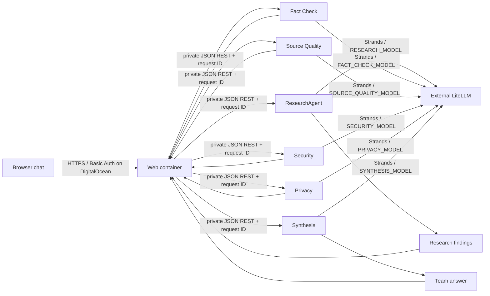

# ViharBot

ViharBot is a web-based research and security platform. A browser talks to a FastAPI web container, which coordinates six independently deployed FastAPI agents using JSON REST. Research gathers structured findings; Fact Check, Source Quality, Security, and Privacy review them; Synthesis produces a final answer. All model inference uses Strands Agents through the separately managed LiteLLM proxy. No direct provider calls are made.

## Architecture



The web service is the only public component in the DigitalOcean App Platform template. All six agents are private internal services. Locally, Compose binds only the web UI to `127.0.0.1:8080`; agent ports stay on the private Compose network. The web app is a coordinator and UI, not a seventh model-backed agent.

The web page presents the synthesized answer plus the findings and reviews in a chat layout. It sends the last four user/assistant turns from the current browser tab as context with each message. The history is held in browser memory only, is not stored server-side, and disappears on reload. Privacy Review receives the current question and structured team results. The privacy analysis itself is a model call through the configured LiteLLM service.

Fact Check and Source Quality review only supplied findings and references. They do not browse the web or independently verify claims. Their outputs call out that limitation and identify follow-up checks.

## Run locally

Copy `.env.example` to `.env`, then set `LITELLM_API_KEY` and LiteLLM aliases available to your account:

```bash
cp .env.example .env
docker compose up --build -d web
```

Open [http://127.0.0.1:8080](http://127.0.0.1:8080). Local Basic Auth is disabled by default because the listener is bound to loopback. To exercise local auth, set `WEB_AUTH_ENABLED=1`, `WEB_USERNAME`, and `WEB_PASSWORD` in `.env`, then recreate the web service.

To run the CLI-style pipeline without the web app:

```bash
docker compose --profile demo run --build --rm orchestrator
```

To stop the local containers:

```bash
docker compose down
```

## DigitalOcean App Platform

[`deploy/digitalocean/app.yaml`](deploy/digitalocean/app.yaml) defines the `viharbot-stage` app with seven containers from this public GitHub repository: a public web service and six private agents. The spec uses public Git clone sources so it does not require linking a GitHub account. App Platform supports Dockerfile-backed components and internal service ports; see the [App Spec reference](https://docs.digitalocean.com/products/app-platform/reference/app-spec/) and [internal routing guide](https://docs.digitalocean.com/products/app-platform/how-to/manage-internal-routing/).

Before creating the app, connect DigitalOcean to GitHub and replace the empty secret values in the template through the DigitalOcean control panel with encrypted runtime secrets:

- Set `LITELLM_API_KEY` on each of the six model-using agent components. The web component does not receive this key.
- Set `WEB_USERNAME` and `WEB_PASSWORD` on the web component. The template enables HTTP Basic Auth for `/` and `/api/chat`; `/health` remains open for platform health checks.
- Configure the six model aliases on their matching agent services.

Then review the spec and create the app using DigitalOcean's [App Platform CLI flow](https://docs.digitalocean.com/products/app-platform/how-to/create-apps/), for example `doctl apps propose --spec deploy/digitalocean/app.yaml` followed by `doctl apps create --spec deploy/digitalocean/app.yaml`. Creating the app provisions billable DigitalOcean resources; no resources are created automatically by this repository.

The App Platform template writes each agent's memory under `/tmp`, which is ephemeral and can be lost when an instance is replaced. Local Compose gives every agent its own memory volume or bind mount. This is an initial deployment layout, not production-grade persistent memory, multi-user identity, or authorization between users.

## Models and credentials

The example aliases use `openai/gpt-5.4-mini` for Research, Fact Check, Source Quality, Privacy, and Synthesis, and `openai/gpt-5.4` for Security. Confirm that each alias is available to your LiteLLM account before using inference. `LITELLM_BASE_URL` defaults to `https://litellm.viharchokshi.com`. ViharBot does not deploy or modify LiteLLM.

Do not commit `.env` or put credentials in source. The API key is sent to LiteLLM over HTTPS and is not logged or passed to the web container. Agent-to-agent and web-to-agent calls use JSON over the private Compose/App Platform network.

## Tests

The default suite mocks model and LiteLLM calls. Run it in Docker with:

```bash
docker compose --profile tests run --build --rm tests
```

Optional live connectivity and inference checks are described in the [LiteLLM integration notes](docs/litellm-integration.md). They are disabled by default; inference checks can consume model quota.

## Project scope

The six-agent lineup is Research, Fact Check, Source Quality, Security, Privacy, and Synthesis. Every agent runs in its own container with its own model alias, memory path, and structured logs. Independent cloud identities and authenticated agent-to-agent calls, per-user accounts, rate limiting, durable web sessions, and production-grade memory remain future work. The current target is a browser-based web app; a native or phone-specific client may be considered later. No AWS resources or DigitalOcean resources are provisioned automatically.
