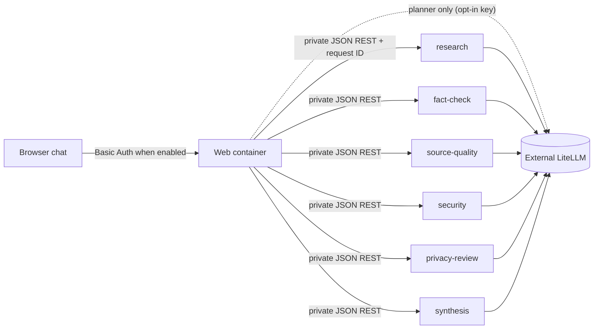

# ViharBot

ViharBot is a browser-based, multi-agent research and security assistant. A FastAPI web container coordinates six independently deployed FastAPI agents over private JSON REST. A named coordinator, Charlie Chatwin, can plan the work one step at a time, but the application, not the model, decides what may run. All model inference goes through Strands Agents to an externally managed [LiteLLM](docs/litellm-integration.md) proxy; there are no direct provider calls.

This README describes what the code on `main` does today. Planned work is labelled as planned. See [development status](docs/development-status.md) for what is implemented, tested, integrated, deployed and operationally validated, and the [Phase 6.5 audit](docs/audits/phase-6.5-architecture-audit.md) for the evidence behind these statements.

## Architecture



The web container serves the UI and runs the orchestration. It is model-backed only for Charlie's planner, and only when iterative orchestration is enabled and a planner alias and key are supplied. Locally, Compose publishes only the web port, on `127.0.0.1:8080`; the six agents stay on the private Compose network. See [architecture](docs/architecture.md) for the full picture.

## Agents and capabilities

Eight agent identities are defined; four are connected to running services. Logical identities and physical services are different things: Scout and Cipher each own two services, and Charlie owns the Synthesis service and the planner.

| Identity | Status | Capability | Service | Default model alias |
|---|---|---|---|---|
| Nova | live | research | `research` | `openai/gpt-5.4-mini` |
| Scout | live | fact check | `fact-check` | `gemini/gemini-3.5-flash` |
| Scout | live | source quality | `source-quality` | `gemini/gemini-3.5-flash` |
| Cipher | live | security assessment | `security` | `openai/gpt-5.4` |
| Cipher | live | privacy review | `privacy-review` | `openai/gpt-5.4-mini` |
| Charlie | live | synthesis | `synthesis` | `openai/gpt-5.4-mini` |
| Charlie | live (opt-in) | planning | in the web container | `CHARLIE_PLANNER_MODEL`, no default |
| Atlas, Sage | planned | none connected | none | none |
| Pixel, Orbit | support roles, not connected | none connected | none | none |

Fact Check reviews only the evidence Research supplied; it does not browse. Each non-trivial verdict must quote that evidence, and the application checks the quote. Source Quality inspects reference strings without fetching them.

## Execution modes

`POST /api/chat` picks the first mode whose flags allow it (`web_app.py`):

| Mode | Flags | Behavior |
|---|---|---|
| Iterative orchestration | `VIHARBOT_ITERATIVE_ORCHESTRATION_ENABLED`, `VIHARBOT_DELEGATION_ENABLED` and `VIHARBOT_IDENTITY_ROUTING_ENABLED` all `true`, plus `CHARLIE_PLANNER_MODEL` | Charlie recommends one step at a time; policy authorizes it; the loop runs it |
| Controlled delegation | `VIHARBOT_DELEGATION_ENABLED` and identity routing | Charlie picks one of two predefined workflows |
| Identity-attributed execution | `VIHARBOT_IDENTITY_ROUTING_ENABLED` | The fixed pipeline, attributed to identities |
| Fixed pipeline | none (the default) | Research, then the specialists in a fixed order |

All flags default to `false`. `POST /api/chat/stream` (live events) works only in iterative mode and returns `409` otherwise. Details: [iterative orchestration](docs/iterative-orchestration.md), [controlled delegation](docs/controlled-delegation.md), [identity execution](docs/identity-execution-integration.md).

## Charlie's orchestration

Each decision is a fresh, stateless planner call that can only propose `delegate <capability>` or `finish`. The application enforces dependencies (Research first; Security needs Research; Privacy Review and Synthesis need Research and Security), freshness of versioned results, budgets (8 decisions, 6 executions, 2 repeats, 120 seconds, 2 refused actions by default) and an absolute request deadline. A recommendation is never an authorization.

## Live observability

With iterative mode on, the page streams real events as they happen: Charlie's planning, delegations, each agent starting and finishing, dependencies, superseded evidence and the final answer. It shows them as a chat between Charlie and the specialists, with the model for each speaker when the service reported it (requires `VIHARBOT_DEV_DIAGNOSTICS_ENABLED`). The chat wording is templated from recorded events, not generated by the agents' models. The protocol is documented in [live observability](docs/live-observability.md).

## Models and credentials

Every model call goes through `build_agent()` (`src/viharbot/model_agent.py`), which builds a Strands `LiteLLMModel` pointed at LiteLLM. Each agent container gets its own alias and `LITELLM_API_KEY`. The web container receives a key only if you opt in with `WEB_LITELLM_API_KEY` (needed for Charlie's planner). `LITELLM_BASE_URL` defaults to `https://litellm.viharchokshi.com`. A configured alias does not prove it works: confirm each alias is available to your LiteLLM account first (see [LiteLLM integration](docs/litellm-integration.md)). ViharBot does not deploy or modify LiteLLM. Never commit `.env`.

## Run locally

```bash
cp .env.example .env     # set LITELLM_API_KEY and aliases your account can use
docker compose up --build -d
```

Open [http://127.0.0.1:8080](http://127.0.0.1:8080). Local Basic Auth is off by default because the listener is bound to loopback; set `WEB_AUTH_ENABLED=1`, `WEB_USERNAME` and `WEB_PASSWORD` to try it. To turn on live orchestration, add the three flags, `CHARLIE_PLANNER_MODEL` and `WEB_LITELLM_API_KEY` to `.env` (this makes billable calls). A CLI-style run: `docker compose --profile demo run --build --rm orchestrator`. Stop with `docker compose down`.

## Tests

The default suite mocks all model and LiteLLM calls and is the authoritative one. Run it on the host with Node installed (the UI tests run the page's real script in a fake DOM):

```bash
python -m pytest -q
```

Two environment notes. A local `.env` is loaded by python-dotenv and can flip the feature flags on, which makes about 15 tests fail; move `.env` aside when running tests. The Docker profile (`docker compose --profile tests run --build --rm tests`) does **not** run the full suite today: its image has no Node, no `compose.yaml`, no `.env.example` and no `images/`, so one test module fails to import and several others fail. See [development status](docs/development-status.md). Opt-in live checks (`RUN_LITELLM_INTEGRATION`, `RUN_LITELLM_INFERENCE`) and `scripts/fact_check_eval/run.py` make billable calls and are off by default.

## Deployment

Pushing to `main` updates source only; nothing deploys automatically.

| Target | State |
|---|---|
| Local Docker Compose | The development environment (seven services plus `orchestrator` and `tests` profiles) |
| DigitalOcean App Platform | A template exists in [`deploy/digitalocean/app.yaml`](deploy/digitalocean/app.yaml) (seven components, `deploy_on_push: false`). **No Stage app is currently running.** The committed spec keeps every optional mode off, so a Stage built from it runs the fixed pipeline and `/api/chat/stream` answers `409` |
| AWS / Bedrock AgentCore | Compatibility code and notes only ([AgentCore notes](deploy/agentcore/README.md)); nothing is deployed and the streaming route is not bridged |

Before deploying to Stage, finish local verification, summarize the change and any monthly cost change, then ask: **"Do you want to promote this dev build to Stage?"** and wait for an affirmative answer for that build. Approval alone does not establish success: verify the deployment status and `/health`. See [deployment strategy](docs/deployment-strategy.md).

## Security boundaries

* All web routes except `/health` use the same shared Basic Auth when enabled (`/`, `/images/*`, `/api/chat`, `/api/chat/stream`). It is not per-user identity.
* The six agents have **no authentication**; they rely on the private network. Do not publish their ports.
* The browser never receives an agent key. Logs hold agent, request ID, destination, alias, duration and error type, never prompts, findings or keys.
* Model output is untrusted: the page renders it with `textContent`, and Markdown answers produce no links or HTML.

## Known limitations

* Agent memory is append-only JSONL, written but never read back, and ephemeral on App Platform.
* Agent-to-agent REST is unauthenticated; identities do not have separate cloud permissions.
* Calls run one at a time, and cancelling a browser request does not stop work already in flight.
* Planned, not built: per-user accounts, durable sessions and memory, authenticated inter-agent calls, distributed runtimes, Atlas, Sage, Pixel and Orbit.

## Documentation

[Architecture](docs/architecture.md) · [Development status](docs/development-status.md) · [Phase 6.5 audit](docs/audits/phase-6.5-architecture-audit.md) · [Live observability protocol](docs/live-observability.md) · [Iterative orchestration](docs/iterative-orchestration.md) · [Controlled delegation](docs/controlled-delegation.md) · [Identity execution](docs/identity-execution-integration.md) · [Personality-aware inference](docs/personality-aware-inference.md) · [Agent identities](docs/agent-identity-architecture.md) · [Agent communication](docs/agent-communication.md) · [LiteLLM](docs/litellm-integration.md) · [Deployment](docs/deployment-strategy.md) · [Identity and security](docs/identity-and-security.md) · [Memory](docs/memory-architecture.md) · [Observability](docs/observability.md) · [AgentCore](deploy/agentcore/README.md)
