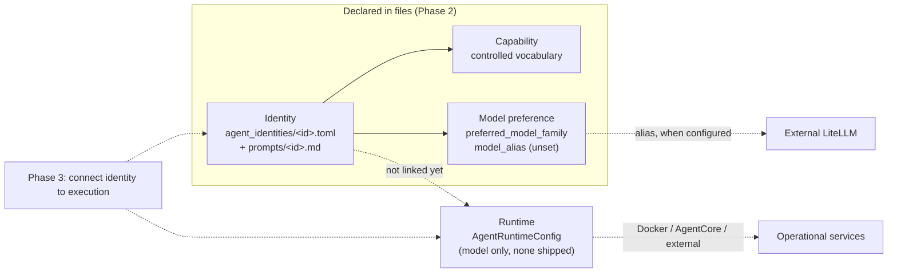

# Agent identity architecture

> **Historical (Phase 2), still accurate for the identity model.** Its statement that identities are not connected to execution was true when written. Since Phase 3 the application binds four identities to running services; see [architecture](architecture.md) and [identity execution integration](identity-execution-integration.md). Atlas, Sage, Pixel and Orbit remain unconnected (planned).

Phase 2 adds declarative configuration for eight agent identities. It does not connect them to execution. The six operational agents (Research, Fact Check, Source Quality, Security, Privacy Review, Synthesis), their prompts, model aliases, endpoints and the web pipeline are unchanged. Nothing in the request path imports the identity modules.

## Four separate concepts



| Concept | Question | Where it lives |
|---|---|---|
| Identity | Who is the agent? | `AgentIdentity` and one TOML file plus one prompt per agent |
| Capability | What is it suited to do? | `Capability` enum on the identity |
| Model | Which model does it prefer? | `preferred_model_family` (text) and optional `model_alias` |
| Runtime | Where and how does it run? | `AgentRuntimeConfig`, separate from the identity |

An identity file cannot contain runtime fields; unknown keys are rejected. A runtime config refers to an identity only by `agent_id`.

## The eight identities

| ID | Name | Title | Capabilities | Preferred model family |
|---|---|---|---|---|
| `charlie` | Charlie Chatwin | Chief Strategist & AI Orchestrator | synthesis, research | GPT-6 family |
| `nova` | Nova | Director of Research & Knowledge | research, evidence_discovery | Gemini Pro family |
| `atlas` | Atlas | Director of Exploration & Logistics | logistics_planning | Claude Sonnet family |
| `pixel` | Pixel | Director of Creative Intelligence | creative_design | Gemini multimodal family |
| `sage` | Sage | Director of Philosophy & Human Perspective | philosophical_analysis | Claude Opus family |
| `cipher` | Cipher | Chief Security & Risk Officer | security_assessment, privacy_review | GPT-6 family |
| `scout` | Scout | Director of Intelligence & Discovery | evidence_discovery, source_quality, fact_check | Gemini Pro family |
| `orbit` | Orbit | Chief Automation & Engineering Officer | automation_engineering | Claude Sonnet family |

These are configuration objects, not deployed services. Each identity's "intended future role" appears in its `description`.

## Declared versus implemented capabilities

Every identity declares capabilities. Separately, `CAPABILITY_STATUS` in `identity.py` records whether an operational service already performs each capability:

- **implemented**: `research`, `fact_check`, `source_quality`, `security_assessment`, `privacy_review`, `synthesis`. These match the six existing services.
- **planned**: `creative_design`, `philosophical_analysis`, `logistics_planning`, `automation_engineering`, `evidence_discovery`. Nothing executes these.

"Implemented" describes the capability, not the identity. For example, Cipher declares `security_assessment`, but the Security service does not run as Cipher. No identity is connected to execution yet.

## Identity does not imply authorization

A capability describes suitability. It does not grant permission to run commands, call tools, read data or change infrastructure. Orbit declares `automation_engineering` and has no execution or infrastructure access. Tool permissions will need their own explicit design. Identity and prompt files are trusted configuration only because they ship inside the package; user messages cannot select or change them, and no public API exposes them.

## Model selection

`preferred_model_family` is a human-readable preference such as "Claude Sonnet family". It is not a deployed alias, and these families are not assumed to exist in your LiteLLM. `model_alias` holds an actual LiteLLM alias, and it is **unset for all eight identities**. There is no fallback logic and no change to the existing `RESEARCH_MODEL`-style variables or `build_agent()`. All inference continues to go through the external LiteLLM gateway.

To configure an alias later, set `model_alias = "your/alias"` in the identity's TOML file once that alias exists in LiteLLM. Aliases are names only; credentials stay in `LITELLM_API_KEY`, never in these files. Nothing reads `model_alias` at runtime yet.

## How the registry loads

`load_registry()` in `identity_registry.py`:

1. Reads each `*.toml` in `src/viharbot/agent_identities/`, in name order.
2. Requires the file name to be a valid id and to equal the `id` field.
3. Reads the prompt from `prompts/<id>.md`. The path comes only from the validated id, and a prompt inside the TOML is rejected.
4. Validates the result as an `AgentIdentity` (strict, immutable, unknown fields rejected).
5. Rejects duplicate ids and an empty directory.

Errors name the file and the field, never the rejected value. Loading is deterministic and makes no network, LiteLLM, AWS, Docker or Strands calls, and nothing loads at import time. `default_registry()` caches one instance. The files live inside the package so they ship in the wheel and the existing images without Dockerfile changes.

```python
from viharbot.identity_registry import default_registry

registry = default_registry()
registry.get("cipher")   # AgentIdentity
registry.list()          # eight identities, in file-name order
```

## Adding an identity

1. Add a `capabilities` value to `Capability` in `identity.py` if you need a new one, and set its status in `CAPABILITY_STATUS`.
2. Create `agent_identities/<id>.toml` with the same fields as the existing files. The `id` must match the file name.
3. Create `agent_identities/prompts/<id>.md` covering role, style, expertise, evidence expectations, security and privacy boundaries, limitations and collaboration. Claim no tools or abilities that do not exist.
4. Update the expected set in `tests/test_agent_identity.py`.

## What Phase 2 does not implement

- No connection between identities and the six operational agents or their prompts.
- No orchestration, delegation, agent selection or negotiation.
- No new services, routes, inference paths, model fallback, multimodal processing or image generation.
- No runtime configs, tool permissions, new memory stores or authentication.
- No Docker, Compose, DigitalOcean or AWS changes.

These belong to later phases.
