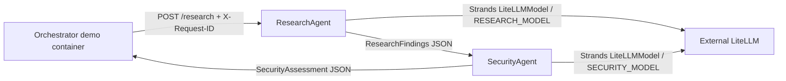

# ViharBot Phase 1 architecture

Two independently deployed FastAPI agents run as Python 3.12 Docker containers. They communicate over simple JSON HTTP on a private Docker bridge network. No A2A, message broker, service mesh, Kubernetes, external database, or complex orchestration framework is used.

## First milestone

ResearchAgent uses the reported working alias openai/gpt-5.4-mini. It accepts a question, calls LiteLLM, and returns typed findings with summary, claims, evidence, confidence, sources, and uncertainties. SecurityAgent is configured for openai/gpt-5.4 and accepts that JSON structure, evaluates it, and returns risk level, implications, recommendations, and uncertainties. Its alias is not considered verified until a real HTTPS chat completion returns a valid structured assessment; catalog presence alone is insufficient. A generated request ID is forwarded over both REST calls and returned by both agents.

## Runtime layout

| Service | Runtime | State |
|---|---|---|
| ResearchAgent | Docker / Python 3.12 | Implemented |
| SecurityAgent | Docker / Python 3.12 | Implemented; AgentCore is a future target |
| Orchestrator demo | Short-lived Docker container | Coordinates the two calls |

Compose does not publish service ports. The demo and both agents join viharbot-agent-network. The bridge allows outbound HTTPS to LiteLLM while keeping agent endpoints unpublished to the host.

## Inference

Both agents construct Strands LiteLLMModel instances with use_litellm_proxy=True, LITELLM_BASE_URL, and LITELLM_API_KEY. RESEARCH_MODEL and SECURITY_MODEL are aliases configured in LiteLLM, not provider model IDs. Provider credentials and routing remain external. There is no direct Bedrock or other provider client.

## Memory and logs

Research and Security write only to separate JSONL files mounted at data/research and data/security. Structured logs include agent name, request ID, requested model alias, duration, and error type. Prompts and keys are excluded.

## AWS and AgentCore

No AWS resources are provisioned. SecurityAgent starts in Docker. Before moving it to AgentCore, verify the selected runtime entrypoint, network access to LiteLLM, identity/authentication setup, and how the FastAPI JSON interface is exposed. This design does not presume AgentCore will run the container unchanged.

## References

- [Strands LiteLLM model provider](https://strandsagents.com/docs/user-guide/sdk/model-providers/)
- [Strands structured output](https://strandsagents.com/docs/user-guide/sdk/agents/structured-output/)
- [LiteLLM](https://docs.litellm.ai/docs/)
