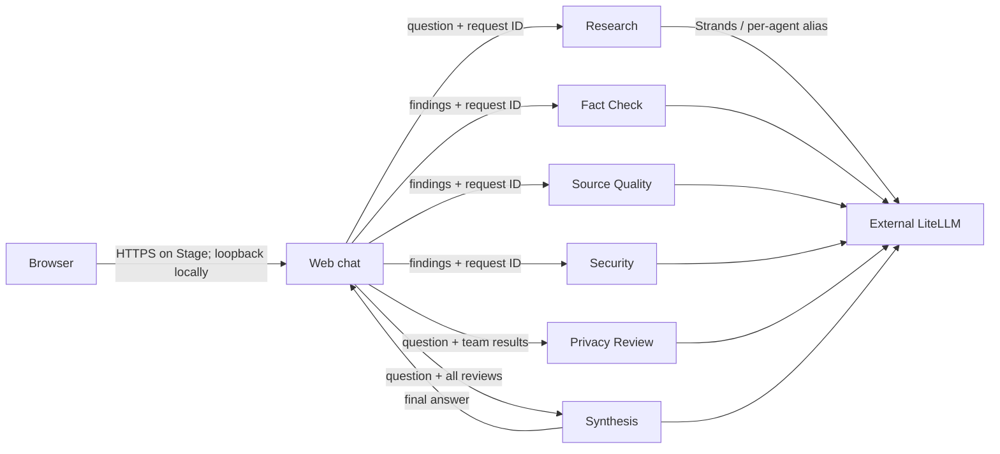

# ViharBot multi-agent architecture

The web chat coordinates six independently deployed FastAPI agents with plain JSON REST. Each model-backed agent uses Strands through the external LiteLLM OpenAI-compatible API. The web service is a presentation layer and coordinator, not a model-backed agent. No provider-native inference, broker, A2A protocol, service mesh, database, or orchestration framework is used.

## Request flow

The coordinator executes the calls in order: Research, Fact Check and Source Quality in parallel-ready independent roles (currently sequential), Security, Privacy Review, and Synthesis. It passes the same request ID to every agent and logs each destination, latency, model alias where applicable, and error type. A full chat turn makes six model requests, increasing response latency and model usage compared with the two-agent setup.

Fact Check compares claims only to evidence supplied by ResearchAgent. Source Quality inspects the provided reference strings without fetching them. Neither agent can independently verify current external facts. Their typed outputs identify limitations and human follow-up.

The browser keeps the last four user/assistant turns in page memory and sends them as context with the next message. The web service does not persist chat turns. The user question and research findings pass through the configured LiteLLM service for each required specialist review; keep the LiteLLM endpoint and its data-handling policy appropriate for the data users submit.

## Runtime layout

| Service | Model alias | State |
|---|---|---|
| Web chat | None | Browser history only; public on Stage and loopback locally |
| Research | `RESEARCH_MODEL` | Isolated JSONL result memory |
| Fact Check | `FACT_CHECK_MODEL` | Isolated JSONL result memory |
| Source Quality | `SOURCE_QUALITY_MODEL` | Isolated JSONL result memory |
| Security | `SECURITY_MODEL` | Isolated JSONL result memory |
| Privacy Review | `PRIVACY_MODEL` | Isolated JSONL result memory |
| Synthesis | `SYNTHESIS_MODEL` | Isolated JSONL result memory |

Local Compose publishes only the web port on loopback. Each agent runs in a separate container and has its own memory volume or bind mount. DigitalOcean exposes only the web component; the six agents use private internal port 8000. Its memory paths are under `/tmp`, which is ephemeral.

The four new specialists share the `Dockerfile.specialist` image while each runs as a separate container with a distinct `AGENT_KIND`, model alias, service identity, and memory volume/path. Research and Security retain their dedicated Dockerfiles.

## Inference, identity, and permissions

All six agents construct Strands `LiteLLMModel` instances with `use_litellm_proxy=True`. Each container receives its own model alias and LiteLLM secret. The web service does not receive a LiteLLM key. No AWS resources or AgentCore runtime are configured.

Container separation and private memory provide basic isolation, but agent-to-agent REST has no authentication within Compose or the App Platform private network. Separate container identities do not yet provide per-agent cloud permissions. The web UI's Stage Basic Auth is a shared login, not per-user identity or authorization.

Eight declarative agent identities (Charlie, Nova, Atlas, Pixel, Sage, Cipher, Scout, Orbit) are defined as configuration only and are not connected to these services. See [Agent identity architecture](agent-identity-architecture.md). Phase 3 adds feature-flagged, identity-attributed execution of the existing pipeline; see [Identity execution integration](identity-execution-integration.md). Phase 4 adds optional, flag-controlled personality-aware inference inside each service; see [Personality-aware inference](personality-aware-inference.md). Phase 5 adds optional, flag-controlled model-assisted workflow selection; see [Controlled delegation](controlled-delegation.md). Phase 6 adds optional, flag-controlled iterative orchestration with per-step authorization; see [Iterative orchestration](iterative-orchestration.md).

## Memory and observability

Each agent stores only its own structured result in an append-only JSONL file under its configured memory directory. It does not intentionally store the incoming question, full transcript, another agent's private memory, or credentials. Agent outputs may still contain sensitive information, so protect the memory files and LiteLLM boundary.

Structured JSON logs contain agent, request ID, destination agent where relevant, model alias, duration, and error type. Prompts, findings, passwords, and API keys are not logged. The same request ID ties all six agent calls to one browser request.

## Future work

Independent cloud permissions, authenticated internal service calls, persistent Stage memory, per-user accounts, rate limiting, and durable sessions remain future work. A native client and Amazon Bedrock AgentCore are not part of the current deployment path. Verify AgentCore capabilities before depending on them.
