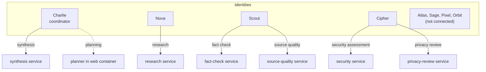
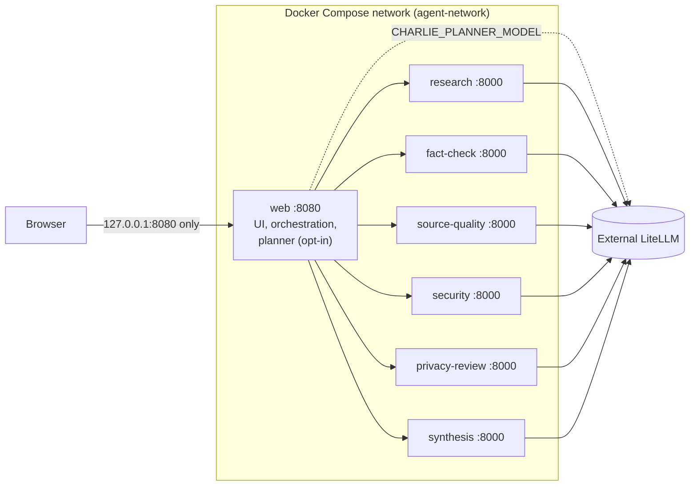
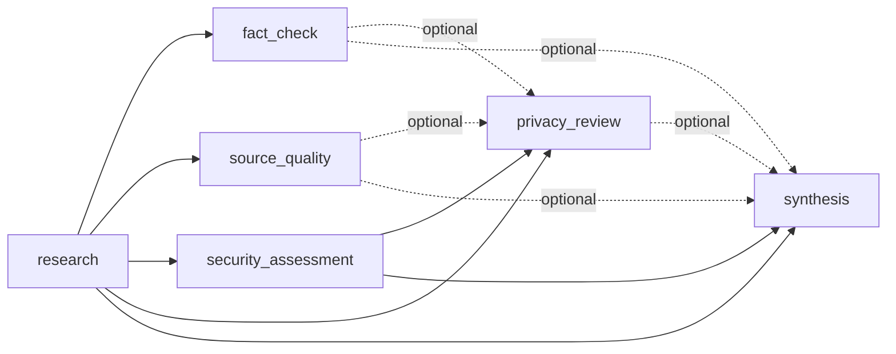
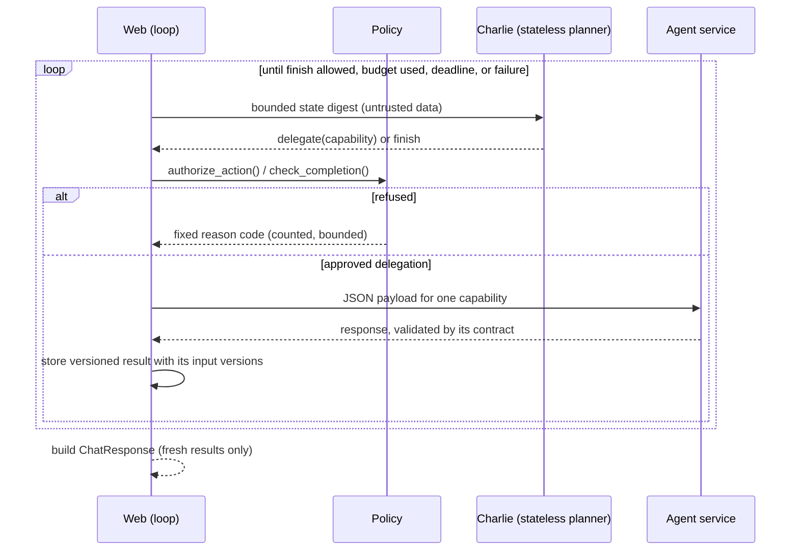
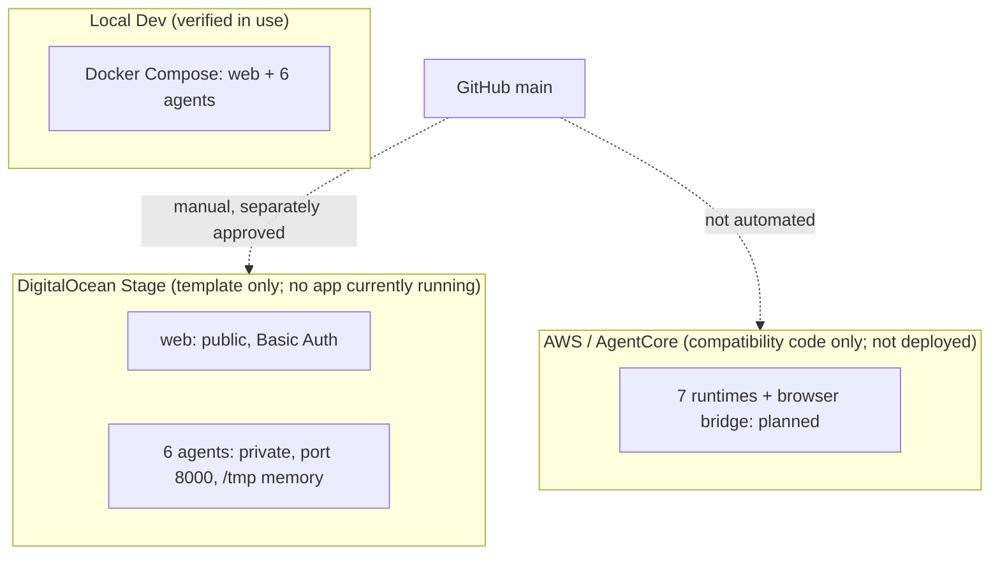

# ViharBot architecture

**Audited revision:** `main` at `f6fa545` (2026-10-28). Evidence and line references are in the [Phase 6.5 audit](audits/phase-6.5-architecture-audit.md). Statements below describe what the code does today; planned work is labelled **planned**. Earlier phase documents are kept as history and linked from the [README](../README.md).

ViharBot is a browser chat that coordinates six independently deployed FastAPI agents over plain private JSON REST. One coordinator identity, Charlie, can plan the work step by step. The application enforces every rule: a model recommends, the application authorizes, the agents execute, the application validates the result, and the application decides completion. All inference goes through Strands to the external LiteLLM proxy. No broker, A2A protocol, service mesh or provider-native inference is used.

## Logical architecture: identities and capabilities

An *identity* is a configured persona. A *capability* is a unit of work. A *service* is a running container. They are not one-to-one.



The bindings live in `src/viharbot/execution_config/bindings.toml`; the identity definitions in `src/viharbot/agent_identities/`. The application resolves a capability to an identity and a service from those bindings, and rejects a recommendation whose binding is missing, disabled or inconsistent. A capability marked `planned` can never run. Identities have no model alias of their own; the model for each service comes from that service's environment. Identity files record a *preferred model family* that is advisory only and currently differs from the runtime choice (for example Nova prefers a Gemini Pro family and runs on an OpenAI alias).

## Runtime architecture



| Service | Entry point | Framework | Model alias source | Memory | Auth |
|---|---|---|---|---|---|
| web | `viharbot.web_app` | FastAPI, uvicorn | `CHARLIE_PLANNER_MODEL` (planner only) | none server-side; browser tab history | Basic Auth when enabled |
| research | `research_agent` | FastAPI, Strands | `RESEARCH_MODEL` | JSONL under `MEMORY_DIR` | none |
| security | `security_agent` | FastAPI, Strands | `SECURITY_MODEL` | JSONL | none |
| fact-check, source-quality, privacy-review, synthesis | `specialist_agent` (`AGENT_KIND`) | FastAPI, Strands | `FACT_CHECK_MODEL`, `SOURCE_QUALITY_MODEL`, `PRIVACY_MODEL`, `SYNTHESIS_MODEL` | JSONL, one volume each | none |

Each agent exposes `GET /health` and one `POST` route, and the AgentCore adapter adds `/ping` and `/invocations`. Agents run on port 8000 and are never published to the host. The four specialists share `Dockerfile.specialist` but are separate containers with their own `AGENT_KIND`, alias and memory volume.

## Execution modes and orchestration

`POST /api/chat` chooses the first mode whose flags allow it: iterative orchestration, controlled delegation, identity-attributed execution, or the fixed pipeline (the default). Flags and details are in the [README](../README.md#execution-modes) and [iterative orchestration](iterative-orchestration.md). The response contract of `/api/chat` is the same in all modes; iterative mode adds one optional `orchestration` object.

### Dependency graph (enforced by `orchestration_policy.py`)



Solid arrows are required inputs. Dotted arrows are optional inputs that are included only while they are fresh. A result is *fresh* when every input it consumed is still the latest version; stale results are excluded from the final answer. Completion requires Research and a Security assessment based on the latest Research.

### Iterative orchestration sequence



Budgets (defaults, with hard ceilings): 8 decisions, 6 executions, 2 repeats per capability, 120 s, 2 refused actions. The deadline is absolute and checked cooperatively.

## Model inference path

Every model call is `build_agent()` in `model_agent.py`: a Strands `Agent` over `LiteLLMModel` with `use_litellm_proxy=True`, `api_base` and key from `LITELLM_BASE_URL` / `LITELLM_API_KEY`. The planner and the six agents all use it. The rest of the code makes only non-inference HTTP calls (web to agents, and `GET /v1/models` in `litellm_client.check_connection`). The web container holds a LiteLLM key only when `WEB_LITELLM_API_KEY` is provided; by default it holds none and the planner is unavailable.

| Service | Default alias (Compose and Stage template) |
|---|---|
| research, privacy-review, synthesis | `openai/gpt-5.4-mini` |
| security | `openai/gpt-5.4` |
| fact-check, source-quality | `gemini/gemini-3.5-flash` |
| Charlie's planner | none; set `CHARLIE_PLANNER_MODEL` deliberately |

## Streaming event flow

```mermaid
sequenceDiagram
    participant B as Browser
    participant S as Stream layer
    participant L as Loop (worker thread)
    B->>S: POST /api/chat/stream
    S->>L: start run (EventEmitter, CancelToken)
    L-->>S: planner_started ... agent_completed ...
    S-->>B: SSE frames, one per event
    L-->>S: result
    S-->>B: final_response, orchestration_completed
    Note over B,S: disconnect sets the CancelToken; no terminal event is sent
```

The 14-event registry, JSON examples, SSE framing and guarantees are specified in [live observability](live-observability.md), which is the canonical reference. Events are emitted only at real execution boundaries; the browser's chat wording is templated from them.

## Memory boundaries

Each agent appends its own structured result to a JSONL file under its `MEMORY_DIR` (`memory.py`). Nothing reads those files back: they are an audit trail, not retrievable context, and no agent can see another's memory. Local Compose uses bind mounts for Research and Security and named volumes for the specialists; App Platform uses `/tmp` and loses them on replacement. The web service stores no chat turns; the browser keeps the last four in tab memory and sends them as context.

## Authentication boundaries

The web app uses one shared HTTP Basic credential when `WEB_AUTH_ENABLED` is on, applied to `/`, `/images/*`, `/api/chat` and `/api/chat/stream`; `/health` is open. The agents have no authentication, and agent-to-agent traffic relies on the private network. Request IDs correlate logs and are not credentials. Separate containers do not yet have separate cloud permissions.

## Deployment topology



A push to `main` deploys nothing. See [deployment strategy](deployment-strategy.md).

## Implemented versus planned

| Area | Implemented | Planned or missing |
|---|---|---|
| Independent agents | Separate containers, aliases, memory paths, structured logs | Per-agent cloud identities and permissions |
| Orchestration | Four modes, stateless planner, policy, freshness, budgets, deadline | Persistent planner state; parallel execution |
| Observability | Request ID, structured logs, live SSE events, model labels | Traces and a hosted log destination; token and cost metrics |
| Memory | Write-only JSONL per agent | Durable, isolated, retrievable memory |
| Communication | Plain JSON REST, validated contracts | Authenticated and observable inter-agent calls |
| Runtimes | Docker Compose; DigitalOcean template | AWS EC2 and AgentCore deployment, distributed coordination |
| Identities | Four live, four defined only | Atlas, Sage, Pixel, Orbit behavior |
