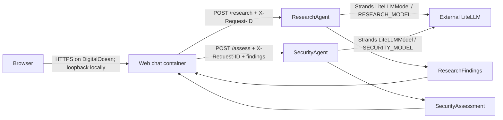

# ViharBot Phase 1 architecture

Phase 1 has one browser-based chat interface in front of two independently deployed FastAPI agents. The web service coordinates ResearchAgent and SecurityAgent with plain JSON HTTP. Both model-backed agents use Strands through the external LiteLLM OpenAI-compatible API. No provider-native inference, broker, A2A protocol, service mesh, database, or orchestration framework is used.

## Request flow

The web service is a presentation layer and REST coordinator; it is not a separate foundation-model agent. It sends each current message to ResearchAgent, then sends the returned findings to SecurityAgent. It returns both typed outputs to the browser. A request ID is forwarded to both services and included in the response.

The browser holds the last four user/assistant chat turns in page memory and sends them as context on the next request. The web service does not persist those turns. The context is included in the ResearchAgent question and treated as untrusted input. SecurityAgent receives only the current structured ResearchFindings.

## Runtime layout

| Service | Runtime | Exposure | State |
|---|---|---|---|
| Web chat | Docker / FastAPI | Loopback `127.0.0.1:8080` locally; public web component on DigitalOcean | Implemented; browser history is page-memory only |
| ResearchAgent | Docker / Python 3.12 | Private service port 8000 | Implemented; isolated JSONL result memory |
| SecurityAgent | Docker / Python 3.12 | Private service port 8000 | Implemented; isolated JSONL result memory |
| Orchestrator demo | Short-lived Docker container | Private Compose network | Optional CLI-style demonstration |

Local `compose.yaml` publishes only the web port on loopback. Research and Security ports are reachable only on the Compose network. `deploy/digitalocean/app.yaml` configures the web component as public and declares internal port 8000 for each agent. App Platform internal routing uses the component names `research` and `security`.

## Inference and permissions

Both agents construct Strands `LiteLLMModel` instances with `use_litellm_proxy=True`. `RESEARCH_MODEL` and `SECURITY_MODEL` are independently configured aliases. The web service does not receive the LiteLLM API key. The DigitalOcean template assigns a secret key to each model-using service; whether those values are identical or distinct depends on LiteLLM key policy.

The application has no per-agent AWS identity or independent cloud permission model. Each service is a separate container with independent environment and memory paths, but agent-to-agent REST is not authenticated inside the private network. The web UI uses HTTP Basic Auth in the DigitalOcean template; this is a single shared login, not per-user identity or authorization. Do not expose a deployment without configuring its credentials.

## Memory and observability

Research and Security write separate JSONL files. Compose mounts these independently at `data/research` and `data/security`. The DigitalOcean template uses `/tmp/viharbot-memory`, so its records are ephemeral. No chat transcript is stored by the web service.

Structured JSON logs contain agent, request ID, destination agent where relevant, model alias, duration, and error type. Prompts, findings, passwords, and API keys are not logged. The same request ID ties the web, research, and security calls together.

## DigitalOcean and future direction

DigitalOcean App Platform is the current cloud target. The App Spec builds each component from its Dockerfile in this repository. Only the web service has a public HTTP port; the two agents use App Platform internal ports. The service must listen on `0.0.0.0` at the configured port. No AWS resources are provisioned, and AgentCore is not part of the current deployment path.

The long-term design has six planned agents. Only ResearchAgent and SecurityAgent are implemented. The current client is a web app; a native or phone-specific client is deferred. See [DigitalOcean App Spec documentation](https://docs.digitalocean.com/products/app-platform/reference/app-spec/) and [internal routing documentation](https://docs.digitalocean.com/products/app-platform/how-to/manage-internal-routing/).
