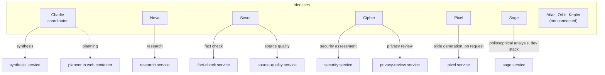
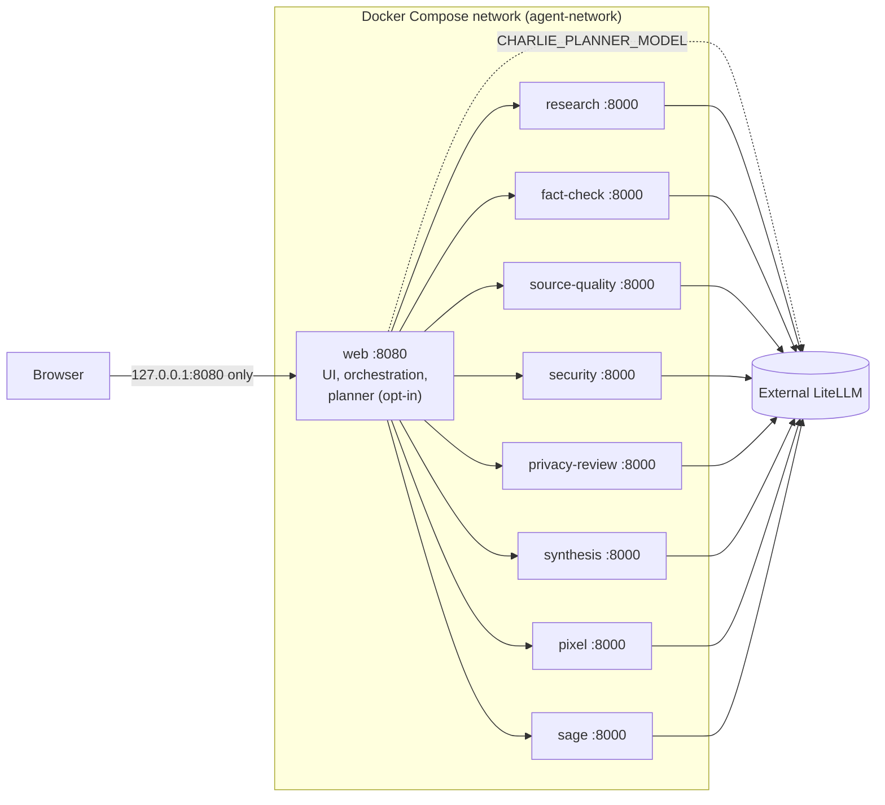
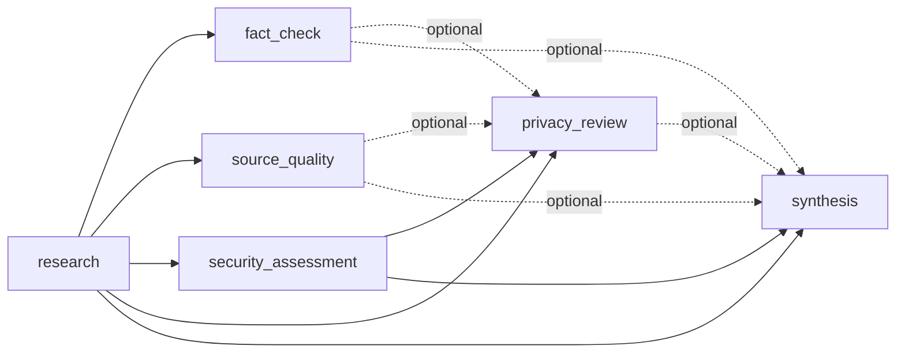
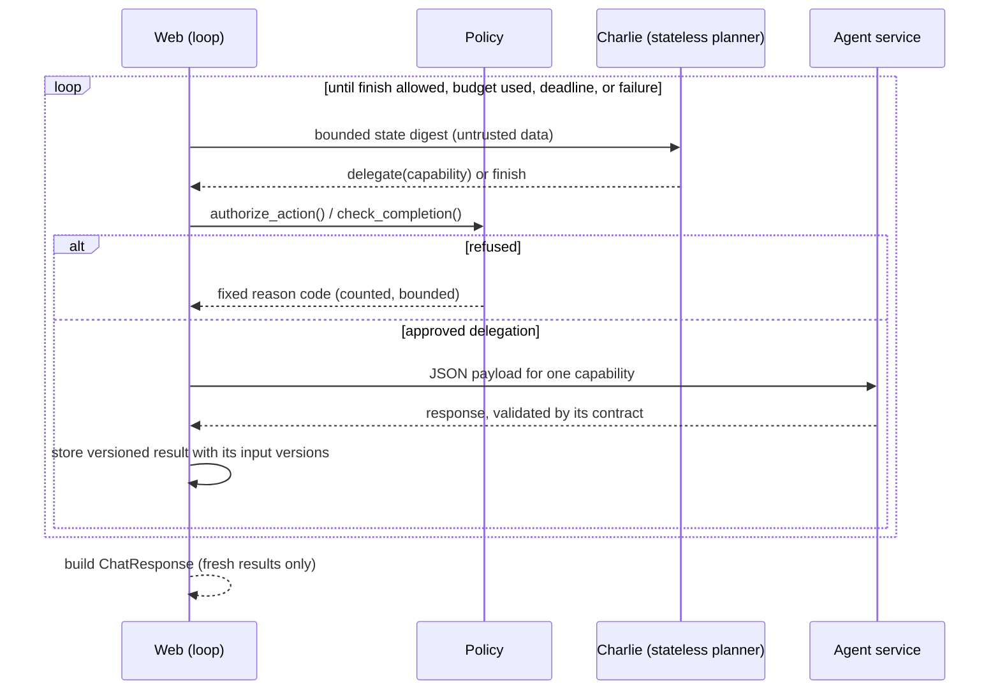

# ViharBot architecture

**Reconciled revision:** `main` at `9e149d2` (2026-11-06). This update corrected the agent roster, services, execution modes, authentication and deployment statements against the code. Line references in the [Phase 6.5 audit](audits/phase-6.5-architecture-audit.md) date from `f6fa545` (2026-10-28) and are historical. Statements below describe what the code does today; planned work is labelled **planned**. Earlier phase documents are kept as history and linked from the [README](../README.md).

ViharBot is a browser chat that coordinates eight independently deployed FastAPI agent services (six core services plus Pixel and Sage) over plain private JSON REST. One coordinator identity, Charlie, can plan the work step by step. The application enforces every rule: a model recommends, the application authorizes, the agents execute, the application validates the result, and the application decides completion. All inference goes through Strands to the external LiteLLM proxy (the one scoped exception, Kepler on allowlisted Bedrock models, is [ADR-011](adr/ADR-011-kepler-inference-exception.md) and has no code that calls a model yet). No broker, A2A protocol, service mesh or provider-native inference is used.

## Logical architecture: identities and capabilities

An *identity* is a configured persona. A *capability* is a unit of work. A *service* is a running container. They are not one-to-one.



The bindings live in `src/viharbot/execution_config/bindings.toml`; the identity definitions in `src/viharbot/agent_identities/`. The application resolves a capability to an identity and a service from those bindings, and rejects a recommendation whose binding is missing, disabled or inconsistent. A capability marked `planned` can never run. Identities have no model alias of their own; the model for each service comes from that service's environment. Identity files record a *preferred model family* that is advisory only and currently differs from the runtime choice (for example Nova prefers a Gemini Pro family and runs on an OpenAI alias).

## Runtime architecture



| Service | Entry point | Framework | Model alias source | Memory | Auth |
|---|---|---|---|---|---|
| web | `viharbot.web_app` | FastAPI, uvicorn | `CHARLIE_PLANNER_MODEL` (planner only) | none server-side; browser tab history | Basic Auth when enabled |
| research | `research_agent` | FastAPI, Strands | `RESEARCH_MODEL` | JSONL under `MEMORY_DIR` | none |
| security | `security_agent` | FastAPI, Strands | `SECURITY_MODEL` | JSONL | none |
| fact-check, source-quality, privacy-review, synthesis | `specialist_agent` (`AGENT_KIND`) | FastAPI, Strands | `FACT_CHECK_MODEL`, `SOURCE_QUALITY_MODEL`, `PRIVACY_MODEL`, `SYNTHESIS_MODEL` | JSONL, one volume each | signed assertions, opt-in (`VIHARBOT_SERVICE_AUTH`); off by default |
| pixel | `pixel_agent` | FastAPI, Strands | `PIXEL_MODEL` | deck files under `MEMORY_DIR/pixel` | none |
| sage | `sage_agent` | FastAPI, Strands | `SAGE_MODEL` | JSONL | none |

Each agent exposes `GET /health` and one `POST` route, and the AgentCore adapter adds `/ping` and `/invocations`. Agents run on port 8000 and are never published to the host. The four specialists share `Dockerfile.specialist` but are separate containers with their own `AGENT_KIND`, alias and memory volume.

## Execution modes and orchestration

`POST /api/chat` runs one of two modes: iterative orchestration when the web container has both `CHARLIE_PLANNER_MODEL` and `LITELLM_API_KEY` (`live_team.py`; there is no flag), otherwise the fixed pipeline. The older controlled-delegation and identity-attributed modes are not reachable from `web_app.py` (tracked in [#222](https://github.com/vchokshi/viharbot/issues/222)); their phase documents are history. Slide generation is an optional step after either mode. Details are in the [README](../README.md#execution-modes) and [iterative orchestration](iterative-orchestration.md). The response contract of `/api/chat` is the same in all modes; iterative mode adds one optional `orchestration` object.

### Dependency graph (enforced by `orchestration_policy.py`)



Solid arrows are required inputs. Dotted arrows are optional inputs that are included only while they are fresh. A result is *fresh* when every input it consumed is still the latest version; stale results are excluded from the final answer. Completion requires Research and a Security assessment based on the latest Research.

### Iterative orchestration sequence



Budgets (defaults, with hard ceilings): 8 decisions, 6 executions, 2 repeats per capability, 240 s, 2 refused actions. The deadline is absolute and checked cooperatively.

## Model inference path

Every model call is `build_agent()` in `model_agent.py`: a Strands `Agent` over `LiteLLMModel` with `use_litellm_proxy=True`, `api_base` and key from `LITELLM_BASE_URL` / `LITELLM_API_KEY`. The planner and all eight agent services use it. The rest of the code makes only non-inference HTTP calls (web to agents, and `GET /v1/models` in `litellm_client.check_connection`). The web container holds a LiteLLM key only when `WEB_LITELLM_API_KEY` is provided; by default it holds none and the planner is unavailable.

| Service | Default alias (Compose and Stage template) |
|---|---|
| research | `gpt-6.1-sol` (local Compose and the Stage spec) |
| privacy-review, synthesis, pixel | `openai/gpt-5.4-mini` (the same `openai/` form as Security; the bare `gpt-5.4-mini` is retired) |
| security | `openai/gpt-5.4` |
| fact-check, source-quality | `gemini/gemini-3.5-flash` |
| Charlie's planner | `gpt-6-luna` in local Compose; unavailable until a key is passed to the web container (there is no flag) |

## Streaming event flow

```mermaid
sequenceDiagram
    participant B as Browser
    participant S as Stream layer
    participant L as Loop (worker thread)
    B->>S: POST /api/chat/stream
    S->>L: start run (EventEmitter, CancelToken)
    L-->>S: planner_started ... agent_completed ...
    S-->>B: SSE frames, one per event
    L-->>S: result
    S-->>B: final_response, orchestration_completed
    Note over B,S: disconnect sets the CancelToken; no terminal event is sent
```

The 14-event registry, JSON examples, SSE framing and guarantees are specified in [live observability](live-observability.md), which is the canonical reference. Events are emitted only at real execution boundaries; the browser's chat wording is templated from them.

## Memory boundaries

Each agent appends its own structured result to a JSONL file under its `MEMORY_DIR` (`memory.py`). Nothing reads those files back: they are an audit trail, not retrievable context, and no agent can see another's memory. Local Compose uses bind mounts for Research and Security and named volumes for the specialists; App Platform uses `/tmp` and loses them on replacement. The web service stores no chat turns; the browser keeps the last four in tab memory and sends them as context.

## Authentication boundaries

The web app uses one shared HTTP Basic credential when `WEB_AUTH_ENABLED` is on, applied to `/`, `/images/*`, `/api/chat` and `/api/chat/stream`; `/health` is open. Agent-to-agent traffic relies on the private network. The four specialist services can verify Ed25519-signed assertions (`service_auth.py`, ADR-006 step A2) when `VIHARBOT_SERVICE_AUTH` is set, and the web process can sign outbound calls to them when `VIHARBOT_OUTBOUND_AUTH` is set; both are off by default. Research, Security, Pixel and Sage verify nothing. Extending authentication is deferred for Stage ([#235](https://github.com/vchokshi/viharbot/issues/235)). Request IDs correlate logs and are not credentials. Separate containers do not yet have separate cloud permissions.

## Deployment topology

```mermaid
flowchart TB
  subgraph Local["Local Dev (verified in use)"]
    LC[Docker Compose: web + 8 agents]
  end
  subgraph Stage["DigitalOcean Stage (template only; no app currently running)"]
    DW[web: public, Basic Auth]
    DA[6 agents (no Pixel or Sage): private, port 8000, /tmp memory]
  end
  subgraph AWS["AWS / AgentCore (compatibility code; no runtime deployed; Kepler lab foundation provisioned)"]
    AG[7 runtimes + browser bridge: planned]
  end
  GH[GitHub main] -. manual, separately approved .-> Stage
  GH -. not automated .-> AWS
```

A push to `main` deploys nothing. See [deployment strategy](deployment-strategy.md).

## Implemented versus planned

| Area | Implemented | Planned or missing |
|---|---|---|
| Independent agents | Separate containers, aliases, memory paths, structured logs | Per-agent cloud identities and permissions |
| Orchestration | Live team or fixed pipeline, stateless planner, policy, freshness, budgets, deadline | Persistent planner state; parallel execution ([#234](https://github.com/vchokshi/viharbot/issues/234)) |
| Observability | Request ID, structured logs, live SSE events, model labels | Persisted run traces ([#228](https://github.com/vchokshi/viharbot/issues/228)); token and cost metrics ([#231](https://github.com/vchokshi/viharbot/issues/231)); a hosted log destination |
| Memory | Write-only JSONL per agent | Retention guardrail and engagement id ([#229](https://github.com/vchokshi/viharbot/issues/229)); durable, isolated, retrievable memory (ADR-009, accepted 2026-11-10; not implemented) |
| Communication | Plain JSON REST, validated contracts; opt-in signed assertions on four services | Authentication on all services ([#235](https://github.com/vchokshi/viharbot/issues/235)) |
| Runtimes | Docker Compose; DigitalOcean template (six agents) | One placement file ([#226](https://github.com/vchokshi/viharbot/issues/226)); Kepler on AgentCore ([#198](https://github.com/vchokshi/viharbot/issues/198)); other AWS deployment |
| Identities | Nine defined; six connected to services (Pixel and Sage in the dev stack) | Behavior for Atlas and Orbit; Kepler agent runtime ([#198](https://github.com/vchokshi/viharbot/issues/198)) |

## Adding an operational agent today

An identity needs only a TOML file and a prompt. An operational agent also needs, as of this revision: a `Capability` value and its entries in `CAPABILITY_STATUS` (`identity.py`), `OPERATIONAL_SERVICES` (`execution_bindings.py`), a binding in `execution_config/bindings.toml`, entries in `CANONICAL_ORDER` and `LEGACY_KEYS` (`orchestration_state.py`), `HARD_DEPENDENCIES`, `SOFT_INPUTS` and the planner's `CapabilityName` (`orchestration_policy.py`), a response field in `chat_models.py`, a URL in `web_app.agent_urls()`, `team_models.py`, `outbound_auth.DESTINATION_CAPABILITIES`, and the compose and Stage definitions. Planned improvements: a single placement file ([#226](https://github.com/vchokshi/viharbot/issues/226)) now, and a capability manifest ([#227](https://github.com/vchokshi/viharbot/issues/227)) when a ninth operational agent exists.
