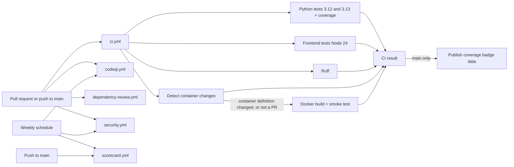

# Continuous integration and quality reporting

ViharBot's quality indicators come from automated GitHub Actions runs. Nothing in the README badges is typed in by hand, and nothing here deploys anything. Every workflow runs offline: no production secrets, no LiteLLM key, no live model calls, no cloud credentials.

## Workflow architecture



| Workflow | Triggers | Purpose |
|---|---|---|
| `ci.yml` | pull request to `main`, push to `main`, manual | Tests, coverage, lint, Docker build and smoke test, one gating job |
| `codeql.yml` | pull request, push to `main`, weekly, manual | GitHub CodeQL for Python, JavaScript and the workflow files |
| `dependency-review.yml` | pull request to `main` | Blocks new dependencies with a known high or critical vulnerability |
| `security.yml` | pull request, push to `main`, weekly, manual | Bandit, pip-audit, Gitleaks, Trivy |
| `scorecard.yml` | push to `main`, weekly, branch-protection changes, manual | OpenSSF Scorecard, published to the public API |
| `contributor-registry.yml` | pull request to `main` (`pull_request_target`, base-branch code only) | Validates `CONTRIBUTORS.md` changes; never grants trust or approval. See [contributor registry automation](governance/contributor-registry-automation.md) |
| `.github/dependabot.yml` | weekly | Update PRs for pip, GitHub Actions and Docker (max 3 open each, grouped, never auto-merged) |

All workflows use `contents: read` by default. Elevated permissions are granted per job and only where needed: `security-events: write` for CodeQL and Scorecard, `id-token: write` for Scorecard publishing, and `contents: write` for the one job that publishes coverage badge data, which runs only on a push to `main`. No workflow uses `pull_request_target`, deploys infrastructure, or reads a secret other than the automatic `GITHUB_TOKEN`. Pull requests from forks therefore run with a read-only token and no secrets. Every third-party action is pinned to a full commit SHA (the release tag is in a comment next to it). Superseded pull-request runs are cancelled; runs on `main` are never cancelled, because their results feed the badges.

## What CI runs

| Job | What it does | Blocks the PR |
|---|---|---|
| Python tests (3.12, 3.13) | `pytest` with coverage and JUnit XML, with Node installed so the UI tests really run | yes |
| Frontend tests (Node 24) | the frontend modules only, and fails if any of them was skipped (a skip means Node did not run the page) | yes |
| Lint (Ruff) | blocking rules from `pyproject.toml`; plus a non-blocking advisory report | blocking rules only |
| Detect container changes | on a pull request, lists the files it changes and decides whether a container definition or `src/` is among them (see below). Always says yes for pushes to `main` and manual runs, and says yes if it cannot tell | yes: a failed or cancelled detection fails `CI result` |
| Docker build and smoke test | runs when a container definition or `src/` changed, and always on pushes to `main` and manual runs. Builds every image (web, research, security, specialists, orchestrator, tests), starts the stack with no key and no optional modes, and checks `/health`, the page, and the stream route's `409` and `422` | yes, when it runs |
| CI result | one required check that fails if any job above did not succeed, and writes the consolidated summary | yes |

### When the Docker job runs

On a pull request the Docker job runs only if the pull request changes a **container definition or the application source baked into the images**: `Dockerfile` or `Dockerfile.*`, `compose.yaml`, `.dockerignore`, `requirements.txt`, `pyproject.toml`, anything under `certs/` or `src/`, or `.github/workflows/ci.yml`. Pull requests that change only docs, tests, scripts, `images/` or `README.md` skip it. Changes are read from the pull request's merge commit against its base, so unrelated changes that landed on `main` meanwhile do not count. On every push to `main` and every manual run the job always runs, so the images are still built and smoke tested after each merge.

The job is skipped, not removed, so `CI result` always reports and can stay a required check. `CI result` accepts a skipped Docker job only when the detection job succeeded and said no container definition changed. If detection fails, is cancelled, or the Docker job fails or is cancelled when it was needed, `CI result` fails. If the changed files cannot be determined, the job runs.

The page has no npm dependencies and no `package.json`. Its tests are pytest modules that run the page's own script in Node against a small fake DOM (`tests/js/`), so the "JavaScript tests" are those modules. Live LiteLLM checks (`RUN_LITELLM_INTEGRATION`, `RUN_LITELLM_INFERENCE`) stay off. The suite's integration-style tests (API contracts through `TestClient`, and the streaming tests against a real loopback server) use mocked inference and run inside the Python job; there is no separate integration job, because it would run the same tests twice.

## Running the checks locally

```bash
python -m pip install -e ".[test]" ruff==0.17.3
python -m pytest --cov            # needs Node for the UI tests; move any local .env aside
ruff check src tests scripts .github/scripts
docker compose config --quiet && docker compose --profile demo --profile tests build
```

A local `.env` is loaded by python-dotenv and can turn the orchestration flags on, which makes about 15 tests fail. CI has no `.env`, so it never sees this.

## Coverage

Coverage is measured with `pytest-cov`. Configuration is in `pyproject.toml`.

| Item | Value |
|---|---|
| Measured | line coverage of `src/viharbot` |
| Included | every module in the application package |
| Excluded | tests, `scripts/`, `.github/scripts/`, the JavaScript in `static/index.html` (exercised by the Node tests but not instrumented), Dockerfiles, and lines marked `pragma: no cover` or `if __name__ == "__main__":` |
| Branch coverage | not measured |
| Baseline | 95.2% (2428 of 2550 lines) in a clean local run before this change |
| Floor | `fail_under = 90`, enforced on every CI run |

The floor sits below the baseline so ordinary changes do not trip it. The weakest modules are `security_client.py` (26%), `litellm_client.py` (77%) and `research_agent.py` (82%). Improvement policy: raise the floor by a few points at a time, only after the measured value has held that high for several merges, and never lower it to let a change through; write the test instead. Consider branch coverage once the line floor is at 95%.

The coverage badge is not a hard-coded number. On each successful push to `main`, the `publish-coverage-badge` job reads that run's `coverage.xml`, writes a [Shields endpoint](https://shields.io/badges/endpoint-badge) JSON file (percentage rounded down, so it never overstates), and commits it to an orphan branch called `badges` that holds nothing else. The README badge reads that file. Codecov was not used: it needs an account, an installed app and an upload token, and shares reports with a third party. The trade-offs of the chosen approach are under Known limitations.

## Security scanning

| Tool | Scope | Policy today | Why |
|---|---|---|---|
| CodeQL | Python, JavaScript (including the page's inline script), workflow files | Reported under Security > Code scanning; the workflow fails only if the analysis itself fails | GitHub's standard query suite, no custom packs |
| Dependency review | dependencies added or changed by a PR | **Blocks** high or critical | Stops known-bad dependencies at review time |
| Gitleaks | full git history | **Blocks** any leak | A committed secret is always wrong. No report is uploaded and no PR comment is posted, so a finding is never copied anywhere |
| Bandit | `src/` | **Blocks** HIGH severity; lower severities reported | Python-specific static analysis |
| pip-audit | the installed environment, including transitive dependencies | Reported, not blocking | A new advisory in a transitive dependency should not turn unrelated PRs red |
| Trivy | Dockerfiles and dependency manifests, HIGH and CRITICAL, fixable only | Reported, not blocking | Container misconfiguration |
| OpenSSF Scorecard | repository practices | Published; not a gate | Supply-chain posture |

**A green workflow badge means the scans ran and nothing crossed the blocking threshold. It does not mean there are no vulnerabilities.** Keep these apart: scan execution, vulnerabilities found, vulnerabilities fixed, and accepted risks.

Baseline measured locally before enabling the scans:

* **Gitleaks:** 29 commits scanned, no leaks.
* **Bandit:** 5 findings, 0 high: two `B310` (`urlopen` on configured URLs; the LiteLLM client validates an HTTP or HTTPS scheme and the agent URLs come from configuration, not requests), one `B104` (binding `0.0.0.0` inside a container, by design), two `B101` (assert). Accepted for now.
* **pip-audit:** no known vulnerabilities in the project's installed dependencies at that time (only `pip` itself, which CI upgrades first).
* **Trivy:** one finding class, `DS-0002` (HIGH): `Dockerfile.orchestrator`, `Dockerfile.research`, `Dockerfile.security` and `Dockerfile.tests` have no non-root `USER`. `Dockerfile.web` and `Dockerfile.specialist` already do. Not fixed here; recommended as a follow-up.

Recommended enforcement over time: keep Gitleaks and Bandit-HIGH blocking; make pip-audit and Trivy block on a fixable CRITICAL once the baseline is clean, with a short, reviewed ignore list (each entry dated and justified) for accepted risks. Findings reports are artifacts with a 14 day retention, and no tool uploads a raw secret.

## Badges

| Badge | Source | Shows | Limitation |
|---|---|---|---|
| CI | native workflow badge, `ci.yml`, `main` | the latest run of the whole CI workflow on `main` | see below |
| Tests | Shields check-runs badge for the job "Python tests (3.12)" on `main` | pass or fail of that job | only the 3.12 job; 3.13 is in the same workflow |
| Coverage | Shields endpoint reading `badges/coverage.json` | measured line coverage from the last green run on `main` | appears after the first successful run on `main`; updated only on pushes to `main` |
| Lint | Shields check-runs badge for "Lint (Ruff)" | the blocking rules | the advisory findings do not affect it |
| Docker Build | Shields check-runs badge for "Docker build and smoke test" | images built and the stack healthy | no image is pushed |
| CodeQL | native workflow badge, `codeql.yml` | the latest analysis run completed | does not mean "no vulnerabilities" |
| Dependency Review | native workflow badge, `dependency-review.yml` | the latest `main` run, if any | the workflow runs on pull requests, so on `main` it may show "no status" |
| Security Scan | native workflow badge, `security.yml` | scans ran, and nothing blocking was found | does not mean "no vulnerabilities" |
| OpenSSF Scorecard | not shown yet | n/a | see below |

A workflow badge shows the latest run on the default branch. It can keep showing an older success until a new run finishes, and shows "no status" before any run. CI runs on every pull request and every push to `main`, so a badge is at most one run behind. The OpenSSF Scorecard badge is deliberately absent: the Scorecard workflow publishes only when it runs on `main`, and its public badge exists only after the first published run. After that run succeeds, add `https://api.scorecard.dev/projects/github.com/vchokshi/viharbot/badge`, linking to `https://scorecard.dev/viewer/?uri=github.com/vchokshi/viharbot`. Do not add it earlier and do not copy a score by hand.

## Artifacts

Retention is 14 days. None contains `.env`, keys, tokens, prompts, conversations or runtime logs.

| Artifact | Contents |
|---|---|
| `viharbot-test-results-py3.12`, `-py3.13` | JUnit XML |
| `viharbot-coverage-xml-py3.12`, `-py3.13` | `coverage.xml` |
| `viharbot-coverage-html-py3.12`, `-py3.13` | `htmlcov/` |
| `viharbot-frontend-results` | JUnit XML for the frontend modules |
| `viharbot-lint-report` | Ruff advisory findings and statistics |
| `viharbot-docker-build-log` | Docker build log, `docker compose ps`, health response |
| `viharbot-security-reports-bandit`, `-pip-audit`, `-trivy` | scanner reports (no Gitleaks report by design) |
| `viharbot-scorecard-sarif` | Scorecard results |

Each job also writes a Markdown summary with real counts (tests, skips, coverage, findings), visible on the run page. A failing job still uploads its artifacts and summary.

## Required repository settings

These are repository settings, not code, and were not changed by the pull request that added the workflows.

| Setting | Why | State when checked |
|---|---|---|
| **Dependency graph** (Settings > Advanced Security) | Dependency review fails without it, and Dependabot needs it | The compare API returned `403` when checked, so it may be off; enable it |
| **Dependabot alerts and security updates** | Vulnerability alerts for the manifests | security updates were reported `disabled` |
| **Code scanning** | Receives CodeQL and Scorecard results | no default setup is configured, which is correct for the advanced workflow here; analyses appear after the first run |
| Secret scanning and push protection | Complements Gitleaks | reported `enabled` |
| Actions permissions | Default workflow token should be read-only | verify under Settings > Actions > General |

**Branch protection** classic rules are not configured on `main`; a ruleset is (see [contributor registry automation](governance/contributor-registry-automation.md) for what it does and does not require). Recommended: require a pull request, and require the status checks `CI result`, `Analyze (python)`, `Analyze (javascript-typescript)`, `Dependency review`, `Bandit (Python static analysis)` and `Gitleaks (secret detection)`. Add status checks only after they have run once, so GitHub can offer them.

## Known limitations

* **Badges can be stale or empty.** A workflow badge reflects the latest run on `main`; it can lag by one run and shows "no status" until the first run.
* **Coverage badge relies on a `badges` branch** written by a workflow with `contents: write`, only on pushes to `main`. A first run is needed before the badge resolves, and Shields caches responses for a few minutes.
* **The per-job badges (Tests, Lint, Docker Build) use Shields' check-runs badge**, which queries the GitHub API through Shields and matches the job name exactly. Renaming a job breaks its badge.
* **Dependency Review runs on pull requests only**, so its badge on `main` reflects the last run on that branch, if any.
* **Gitleaks, Bandit and CodeQL are static analysis.** They find patterns, not every flaw.
* **`images/` and `README.md` do not trigger the Docker job**, although the images copy them. A pull request that changes only those cannot change how an image builds or starts, but a broken or missing file there would be found after merge, by the push-to-`main` run. Add them to the pattern in the `changes` job to check them on pull requests too.
* **The Docker test profile (`docker compose --profile tests ...`) is not used by CI** and still does not run the whole suite: its image lacks Node, `compose.yaml`, `.env.example` and `images/` (see the [development status](development-status.md)). CI runs the suite on the host runner instead.
* **Advisory Ruff findings** (50 in the baseline: 34 unused imports, 10 ambiguous variable names, 5 lambda assignments, 1 unused variable) are reported but not blocking. The blocking set is intentionally small until they are cleaned up.
* **Action versions are pinned to SHAs** and need updating; Dependabot proposes those updates.
* **Third-party services.** Shields.io receives only public repository metadata when a badge is loaded. Scorecard publishes its results to the public OpenSSF API. Trivy downloads its vulnerability database from a public registry. No application data, prompts or secrets are sent anywhere.
