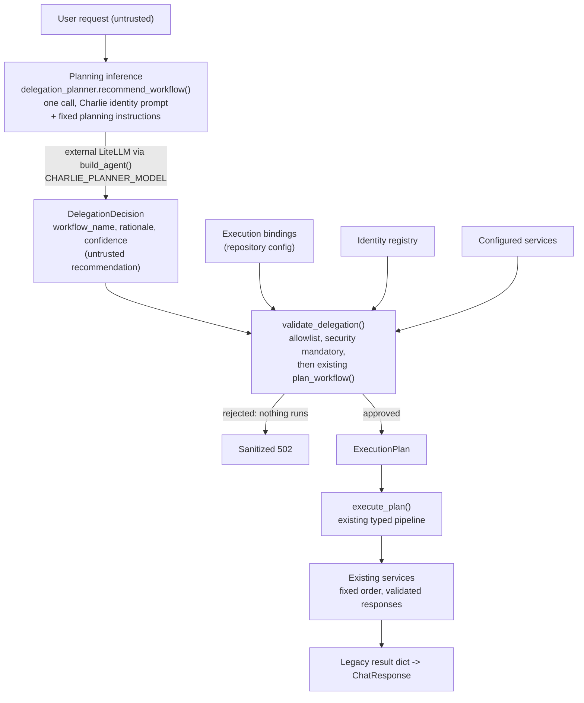

# Controlled delegation

Phase 5 lets Charlie Chatwin **recommend** one of two predefined workflows for a request. The application validates and authorizes the recommendation before anything runs. It is **off by default**, and with the flags off the existing paths are unchanged.

## Model-assisted selection versus autonomous orchestration

| Implemented here | Not implemented |
|---|---|
| One planning inference per request | Multi-step planning or replanning |
| Choosing between two fixed workflows | Arbitrary workflow graphs or ordering |
| Application policy authorizes the choice | The model deciding what is allowed |
| Existing services run in their fixed order | The model invoking services, tools or shell |
| Controlled failure on any problem | Retries, fallbacks, delegation between agents |

Charlie never receives authority. His output is untrusted data that the application accepts or rejects.

## Flow



Trust boundaries, from least to most trusted: **user input** (untrusted) → **LLM recommendation** (untrusted) → **application policy** (authoritative) → **operational execution** (only what policy approved).

## Charlie's planning responsibility

Planning is a separate inference from Charlie's synthesis role. The planner prompt is Charlie's approved identity prompt, the standard precedence clause, and fixed planning instructions. It describes the two workflows and the selection guidance, and it states that Charlie only recommends and has executed nothing. The user's message goes only in the user message. The prompt contains no credentials, endpoints, aliases or service URLs. It uses Charlie's prompt directly and does not depend on the personality-inference flags.

## DelegationDecision

```python
class DelegationDecision(BaseModel):   # frozen, unknown fields rejected
    workflow_name: Literal["full_review", "research_security"]
    rationale: str      # 1-500 chars, never executed, logged or returned
    confidence: Literal["low", "medium", "high"]   # never used for authorization
```

There is no field for services, URLs, ARNs, aliases, tools, credentials, commands or steps, so none can be supplied. An unrecognized workflow name is a validation error and never creates a workflow.

## Workflow selection guidance

`full_review` (Nova research, Scout fact check and source quality, Cipher security and privacy review, Charlie synthesis) is suggested for comprehensive analysis, fact checking, source evaluation, privacy implications, a synthesized recommendation, multiple perspectives or detailed evidence assessment. `research_security` (Nova research, Cipher security) is suggested for a focused research summary, security implications or a concise risk assessment. The guidance is part of the prompt only; it is not an authorization rule. The prompt tells Charlie to prefer `full_review` when a request is ambiguous or touches personal or sensitive information.

## Policy validation

`validate_delegation(decision, registry, bindings, available_services)` runs before any agent is called and makes no model or network calls. It:

1. Requires a real `DelegationDecision`.
2. Requires the workflow to be in an explicit delegable allowlist. A workflow added to the planner later is not delegable until it is added here.
3. Calls the existing `plan_workflow()`, which enforces enabled bindings, implemented capabilities, configured services and the pipeline's dependency order. There is no second source of execution policy.
4. Requires the plan to include the security assessment.

Confidence and rationale are ignored. `research_security` omits Privacy Review by definition, so a model that picks it for a request involving personal data skips that review. This is an accepted limitation of the two approved workflows, not something the policy detects.

## Execution

`run_delegated_pipeline()` calls the planner once, validates, then passes the approved plan to `execute_plan()`. That is the same execution half `run_identity_pipeline()` uses, so transport (HTTP and `agentcore://`), response validation, request ID checks and outbound payloads are unchanged. Services keep their own prompts and aliases. Unexecuted stages stay absent internally and serialize as `null` in `ChatResponse`. Nothing is fabricated and no step is added.

## Configuration and feature flags

| Variable | Purpose | Default |
|---|---|---|
| `VIHARBOT_DELEGATION_ENABLED` | Turns model-assisted selection on | false |
| `VIHARBOT_IDENTITY_ROUTING_ENABLED` | Must also be true; otherwise delegation stays inactive and the existing path runs | false |
| `CHARLIE_PLANNER_MODEL` | The planning model's LiteLLM alias | unset |
| `VIHARBOT_PLANNER_TIMEOUT_SECONDS` | Planning call timeout, clamped to 1-120 | 30 |

`/api/chat` then uses one of three paths: delegation and routing on gives the delegated path, routing alone gives the fixed Phase 3 `full_review`, and neither gives the legacy pipeline. Users cannot choose a workflow, and nothing in the request is read for it. Personality-aware inference stays controlled by its own flags, and none of these variables is set in `compose.yaml`, `.env.example` or the DigitalOcean spec.

**The web service needs LiteLLM credentials to plan.** Today only the six agents receive `LITELLM_BASE_URL` and `LITELLM_API_KEY`. To enable delegation, an operator must add those and `CHARLIE_PLANNER_MODEL` to the browser-facing web service. That widens what a compromise of that service exposes. Phase 5 changes no deployment configuration, so this is a deliberate operator decision.

## LiteLLM routing and the alias

Planning calls go through `build_agent()` (Strands and the external LiteLLM gateway). `build_agent()` gained an optional `timeout`; without it the client arguments are exactly as before. `CHARLIE_PLANNER_MODEL` must be set deliberately. The planner never falls back to the synthesis alias or any other alias and never uses Charlie's preferred model family. A configured alias is not verified to exist.

## Failure behavior

Every failure is a controlled error that returns the existing sanitized 502 and logs the error type only. There is no fallback to `full_review`, no fallback model, no retry and no replanning.

| Problem | Result | Agents run? |
|---|---|---|
| No planner alias | `PlannerUnavailableError` | No |
| Planner failure or timeout | `PlannerInferenceError` | No |
| Invalid structured output | `PlannerInferenceError` or `PlannerOutputError` | No |
| Workflow not delegable, or not a valid decision | `DelegationRejected` | No |
| Disabled binding, missing service, bad order | `PlanningError` | No |
| Malformed agent response | `AgentPipelineError` with activity (existing 502 detail) | Up to the failed stage |

With delegation on, a planner outage is a chat outage.

## Execution budgets

One planning inference per request, one workflow, no recursion, no agent-initiated replanning, no retries, no parallelism and no dynamic services. Each delegated request adds one model call, so extra cost and latency on top of the six-stage run. Planning and execution durations are recorded separately.

## Observability

`orchestrator` logs add `planner_identity`, `model_alias` (the planner alias), `recommended_workflow`, `approved_workflow`, `planning_duration_ms`, `execution_duration_ms` and `delegation_status` to the existing `request_id` and `error`. Statuses are `recommended`, `approved`, `rejected`, `planner_failed`, `execution_failed` and `executed`. `executed` is logged only after the workflow completes, and `execution_duration_ms` is absent from the `approved` line. Questions, rationales, prompts and credentials are never logged. The existing `agent_activity` records are unchanged.

## Public API and UI

`/api/chat` schemas, authentication, request ID handling and 502 handling are unchanged, and the response contains no delegation fields. For `research_security` the optional specialist and synthesis fields are `null`. The current UI shows the research summary as the answer when there is no synthesis and hides the empty sections, so it still renders, but that answer is not a synthesized recommendation. Surfacing the chosen workflow or a synthesis for the short workflow would need a separate UI or API change.

## Security boundaries

A user cannot modify bindings, supply endpoints, select models, create workflows, enable capabilities, grant permissions, run tools or touch infrastructure. A prompt-injection attempt can at worst influence the choice between the two approved workflows. Charlie has no shell, AWS or tool access, and his prompt holds no secrets.

## Limitations and future work

- Only two workflows can be selected, and only one per request.
- The planner's choice is not checked for quality.
- Which workflow ran is visible in logs but not in the API response.
- Later phases may add more workflows or dynamic planning, each needing its own policy and approval. None exists today.
