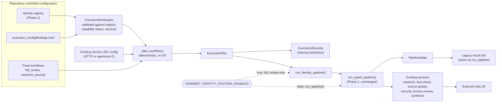

# Identity execution integration

> **Historical (Phase 3), still accurate for what it describes.** Later phases build on these bindings: personality-aware inference (Phase 4), controlled delegation (Phase 5) and iterative orchestration (Phase 6). Current state: [architecture](architecture.md).

Phase 3 lets the orchestrator resolve a named workflow through approved **execution bindings** and run it on the existing six services. It adds identity attribution. It does **not** make the underlying models run with an identity's personality.

## Attribution versus personality-specific inference

- **Implemented:** the orchestrator can say "Nova's research capability ran on the `research` service". That is bookkeeping recorded internally.
- **Not implemented:** the `research` service still uses its original system prompt and its configured model alias (`RESEARCH_MODEL`). Nova's prompt in `agent_identities/prompts/nova.md` is not sent to any model. Connecting personality prompts to inference is a later phase.

Model identity is whatever the service reports. The `model_alias` on an execution record is copied from the service's response, and the service's configured alias stays authoritative.

## Architecture



## ExecutionBinding

```python
class ExecutionBinding(BaseModel):   # frozen, unknown fields rejected
    identity_id: str
    capability: Capability
    service_name: str
    enabled: bool = True
```

Bindings live only in `src/viharbot/execution_config/bindings.toml`. They are kept apart from `agent_identities/` because the identity loader reads every `.toml` there as an identity. A binding holds no URL: endpoints come from the service URL configuration the caller already supplies, so nothing is duplicated.

Every binding is validated against the Phase 2 registry. These are rejected, with errors that name the binding and field but not the value:

- an unknown identity
- an unknown capability
- a capability the identity does not declare
- a capability whose status is `planned`
- an unknown service, or a service that does not fulfill that capability
- a duplicate `(identity, capability)` pair
- more than one enabled binding for the same capability or the same service

An identity's declared capabilities alone authorize nothing. Only a binding in the repository file does.

### Approved bindings

| Identity | Capability | Service |
|---|---|---|
| Nova | research | `research` |
| Scout | fact_check | `fact-check` |
| Scout | source_quality | `source-quality` |
| Cipher | security_assessment | `security` |
| Cipher | privacy_review | `privacy-review` |
| Charlie | synthesis | `synthesis` |

Charlie also declares `research` but is deliberately not bound to it, because the design allows one identity per capability. Atlas, Pixel, Sage and Orbit have no bindings because their capabilities are planned. The bindings describe orchestration responsibility, not new services or personality-specific behavior.

## ExecutionPlan and workflows

`plan_workflow()` in `execution_planner.py` resolves a workflow's capabilities, in order, through the enabled bindings:

```python
class ExecutionStep(BaseModel): identity_id; capability; service_name
class ExecutionPlan(BaseModel): workflow_name; steps   # frozen
```

| Workflow | Steps |
|---|---|
| `full_review` | Nova research, Scout fact check, Scout source quality, Cipher security, Cipher privacy review, Charlie synthesis |
| `research_security` | Nova research, Cipher security |

Workflows are fixed constants. There are no user-defined workflows. Planning is deterministic and makes no network calls, no LLM calls, and builds no Strands agents. It fails with a `PlanningError` for an unsupported workflow, a missing or disabled binding, or a required service that has no configured URL. In particular, `full_review` does not silently skip an unconfigured specialist the way the legacy pipeline does.

`research_security` runs only research then security. The other results stay absent, and no output is invented for stages that did not run.

## Execution

`run_identity_pipeline()` plans the workflow, then calls `run_typed_pipeline()` with only the planned stages. It reuses Phase 1 transport (including `agentcore://` URLs), response validation, request ID checks and outbound payloads. Nothing in `demo.py` changed.

The plan chooses which stages run. The execution **order** is fixed inside `run_typed_pipeline()` by data dependencies (research first; fact check, source quality and security need research; privacy review and synthesis need prior results). The planner validates that a plan is consistent with that order, and execution checks that the executed stages equal the plan. A mismatch is a controlled error. The plan does not dispatch stages itself.

The result is an `IdentityPipelineResult` holding the typed state, the plan and the internal records. `.to_legacy_dict()` returns exactly what `run_pipeline()` returns. If a stage fails, `IdentityPipelineError` is raised. It is a subclass of `AgentPipelineError`, so existing handling works, and it also carries the records so far.

Each `ExecutionRecord` has `identity_id`, `capability`, `service_name`, `request_id`, `duration_ms`, `status` and the service-reported `model_alias`. Records are internal. They are not in the public `AgentActivity` or `ChatResponse`, and Phase 3 adds no logging of prompts or user data.

## Feature flag

`VIHARBOT_IDENTITY_ROUTING_ENABLED` is read on every request and defaults to **false**. It accepts `1`, `true` or `yes`.

- **False:** `/api/chat` calls `run_pipeline()` exactly as before. Identity configuration has no effect.
- **True:** `/api/chat` runs `full_review` through the identity path. The workflow is fixed in server code, so a request cannot choose it, and `research_security` is reachable only through the internal function. The result converts to the unchanged `ChatResponse`. Failures use the existing 502 responses, with no silent fallback to the legacy pipeline.

`compose.yaml` and the DigitalOcean spec do not pass this variable, so deployed containers keep it off. Enabling it there needs a separately approved configuration change.

## Security boundaries

- Identity and capability do not grant permissions. No tool, file, network, infrastructure, AWS or user-data access is added.
- Bindings can only be changed by editing repository configuration. Requests cannot create or alter them, supply service names or supply URLs.
- Service endpoints still come from the existing environment-based URL configuration.
- All inference still goes through the services and the external LiteLLM gateway. No aliases, prompts or models changed.

## Known limitations

- Attribution is not personality. Prompts for the eight identities are still not used for inference.
- Execution order is validated, not dispatched, as described above.
- `full_review` requires all six services; the legacy pipeline tolerates missing specialists.
- Records are not returned on the public API and are not persisted or logged.
- Only one identity can be bound to a capability.

## Future work (not implemented)

Later phases may let identities run with their own prompts and model aliases, select among several eligible identities, or plan dynamically. Any autonomous orchestration, delegation or tool execution needs its own design, permission model and approval. None of that exists today.
