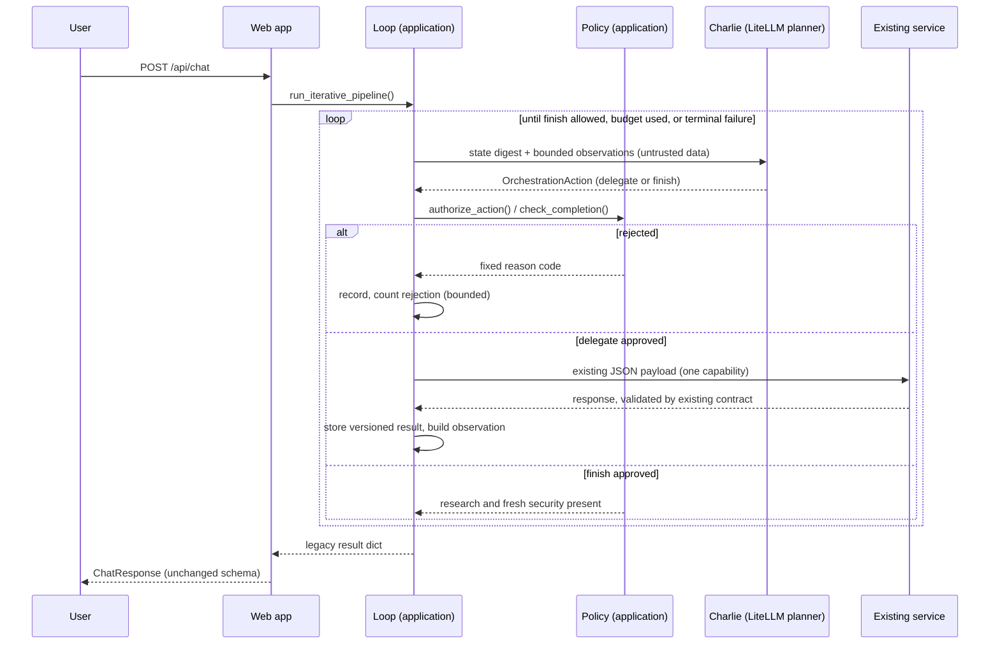

# Iterative orchestration

Phase 6 lets Charlie Chatwin coordinate a request over several decisions instead of choosing one workflow up front. After each approved step he sees a bounded summary of the result and decides what to do next. It is **off by default**, and with the flags off the earlier paths run unchanged.

## Controlled orchestration versus unrestricted autonomy

| Implemented here | Not implemented |
|---|---|
| One action per decision, from a fixed set of six capabilities | Tools, shell, new capabilities, new services |
| The application authorizes every action | Any model output being treated as permission |
| An explicit bounded loop with budgets | Recursion, retries, background work, parallel execution |
| Existing services, bindings and contracts | Changing payloads, endpoints or model aliases |
| Completion decided by application policy | The model declaring a task finished |

Charlie is the coordinator, and the application is the execution authority. Charlie's output is a proposal that policy accepts or rejects.

## Sequence



## Orchestration state

`OrchestrationState` exists for one request in memory only. It is never returned by any API and has no database. It holds:

- `request_id`, `original_question`, `current_goal`, `iteration` (executions started) and `decision_number`
- `completed_steps`: every validated execution as a `StepResult` with its version, the identity that ran it, the service, the duration, the validated envelope and result, and `based_on`, the input versions it used
- `pending_gaps`: up to 5 short unresolved questions Charlie noted
- `decision_history`: the last 32 content-free decision records (action, capability, status, reason code)
- `execution_budget`, `rejected_actions` and `status` (`running`, `completed`, `budget_exhausted`, `failed`)

A repeated capability adds a new version. Earlier versions are kept, so evidence is never silently overwritten. The final `PipelineState` takes the latest version of each capability, in the fixed pipeline order, so the response matches the fixed pipeline's shape.

## Action model

```python
class OrchestrationAction(BaseModel):   # frozen, unknown fields rejected
    action: Literal["delegate", "finish"]
    capability: one of the six implemented capabilities | None
    rationale: str            # 1-300 chars
    unresolved_question: str | None   # 1-200 chars
```

It is one flat model, which suits provider structured-output schemas better than a union. A validator requires a capability for `delegate`, and forbids a capability and an unresolved question for `finish`. There is no field for services, URLs, runtime identifiers, model aliases, tools, commands, credentials or permissions, and planned-only or unknown capability names cannot be expressed. The rationale and the unresolved question are never executed or logged. **The unresolved question is not sent to any service:** outbound payloads are unchanged, so it only informs Charlie's own state.

## Decision loop

Each pass of an explicit `while` loop does the following:

1. Stop if the decision, time or execution budget is used up (see below).
2. Ask Charlie for one action: one stateless LiteLLM call through `build_agent()` with the `CHARLIE_PLANNER_MODEL` alias. There are no retries and no fallback model.
3. For `finish`, check completion policy. For `delegate`, check `authorize_action()`.
4. If rejected, record it, give Charlie a fixed application notice, and count it. The second rejection ends the loop.
5. If approved, run exactly one capability through `invoke_agent()`, the same call-and-validate boundary the fixed pipeline uses. Store the versioned result and update state.

There is no recursion and no parallelism. The loop is bounded because every pass uses a decision and decisions are capped.

## Capability dependencies

| Capability | Identity → service | Requires |
|---|---|---|
| research | Nova → research | nothing |
| fact_check | Scout → fact-check | research |
| source_quality | Scout → source-quality | research |
| security_assessment | Cipher → security | research |
| privacy_review | Cipher → privacy-review | research, security |
| synthesis | Charlie → synthesis | research, security |

`authorize_action()` also requires an enabled binding for the capability, a registered identity that declares it, an implemented capability, a configured service, and remaining repeat, execution and time budget. Outbound payloads are built by the existing legacy builders, and the context keys are always in the fixed pipeline's order, so payloads match the fixed pipeline's bytes whatever order Charlie chooses. Each run records the input versions it used. If research is re-run, anything built on the old version is stale.

## Observations

After each execution Charlie sees an `Observation` derived only from the validated result: capability, identity, status, duration, a summary of at most 600 characters, up to 5 evidence gaps of at most 200 characters, and a stale flag. One serialized observation is capped at 2,000 characters. Observations report what the agent returned. They never claim external verification. They appear in the **user message** under an "untrusted data" label and never in the system prompt. Full results stay in the state.

## Execution budgets

| Budget | Default | Ceiling |
|---|---|---|
| Decisions | 8 | 16 |
| Delegated executions | 6 | 12 |
| Repeats per capability (beyond the first run) | 2 | 3 |
| Total duration | 120 s | 300 s |
| Rejected actions | 2 | n/a |

The first four can be set with `VIHARBOT_ORCH_MAX_DECISIONS`, `_MAX_EXECUTIONS`, `_MAX_REPEATS` and `_MAX_SECONDS`, and are clamped to the ceilings. Model confidence is not an input anywhere. The time budget is checked between calls, so the worst case overruns by one call: a service call can take up to 90 seconds, and a planner call uses the smaller of its configured timeout and the time left. No platform request timeout is configured in this repository and the browser `fetch` has no abort timeout, so check your platform's limit before enabling this. Running all six capabilities once uses the default execution budget, so that run completes by policy without asking Charlie for a seventh decision.

## Completion policy

Finishing needs research and a security assessment that was based on the latest research. Optional results may be absent, and nothing is fabricated. When Charlie asks to finish and policy allows it, the loop ends with no further inference.

| Situation | Behavior |
|---|---|
| Finish with required results fresh | Completed |
| Premature finish (`mandatory_missing`) | Rejected and counted; Charlie is told |
| Security older than the latest research (`security_stale`) | Rejected; security must be re-run |
| Decision, time or execution budget used up, or rejection limit reached, **and** the required results are present and fresh | Completed by policy with the validated results so far (`completion_status` records why) |
| The same limits reached without the required results | Controlled failure: the existing sanitized 502 |
| An agent call fails or returns a malformed response | Terminal: the existing 502 with agent activity |
| The planner fails, times out or returns invalid output | Terminal controlled failure, as in Phase 5 |

## Feature flags

`VIHARBOT_ITERATIVE_ORCHESTRATION_ENABLED` (default false) also requires `VIHARBOT_DELEGATION_ENABLED` and `VIHARBOT_IDENTITY_ROUTING_ENABLED`. If either is off, iterative mode stays inactive and the Phase 5, Phase 3 or legacy path runs. `CHARLIE_PLANNER_MODEL` and `VIHARBOT_PLANNER_TIMEOUT_SECONDS` are reused. Personality-aware inference stays on its own flags. None of these is set in `compose.yaml`, `.env.example` or the DigitalOcean spec. As in Phase 5, the **web service needs LiteLLM credentials** for planning, and Phase 6 changes no deployment configuration.

## Public API and activity

`/api/chat` schemas, authentication, request ID handling and 502 handling are unchanged, and the response contains no orchestration fields. Repeated executions appear as repeated entries in `agent_activity`. The UI shows the research summary as the answer when no synthesis was run.

## Observability

`orchestrator` logs add `iteration`, `decision_number`, `requested_action`, `action_status`, `capability`, `identity_id`, `service_name`, `model_alias`, `execution_duration_ms`, `remaining_budget`, `completion_status` and `error`. `action_status` separates `recommended`, `authorized`, `rejected`, `executed` and `completed`. `executed` is logged only after a validated response arrives, and `completed` only when the loop ends. Questions, rationales, observations and prompts are never logged.

## Security boundaries

Every action is validated by the application: unknown capabilities, disabled bindings, unavailable services, unmet dependencies and budget violations are rejected. A user cannot supply endpoints, models, identities or capabilities. Agent output is untrusted: it is bounded, labelled and kept out of the system prompt, and it cannot widen what policy authorizes. At worst, injected text wastes a decision or prompts an early `finish` that policy rejects. Charlie has no tools, shell or AWS access. His prompt was corrected where Phase 6 made it inaccurate: it now says he recommends the next capability and the application decides whether it runs, and it no longer says orchestration is unavailable.

## Limitations

- Outbound payloads are unchanged, so repeating a capability gives another model sample on the same input unless upstream results changed. Sending refined questions to services needs a versioned payload and is not implemented.
- Cost and latency rise: up to 8 planner calls plus up to 6 service calls per request.
- Which steps ran is visible in logs and `agent_activity` but there is no field for the decision history.
- Time is checked between calls, so a single call can overrun the budget.
- Persona and decision quality are not measured; tests use a mocked planner.
- Only the six implemented capabilities can be delegated. Charlie cannot request a new capability, parallel work or a different model.
