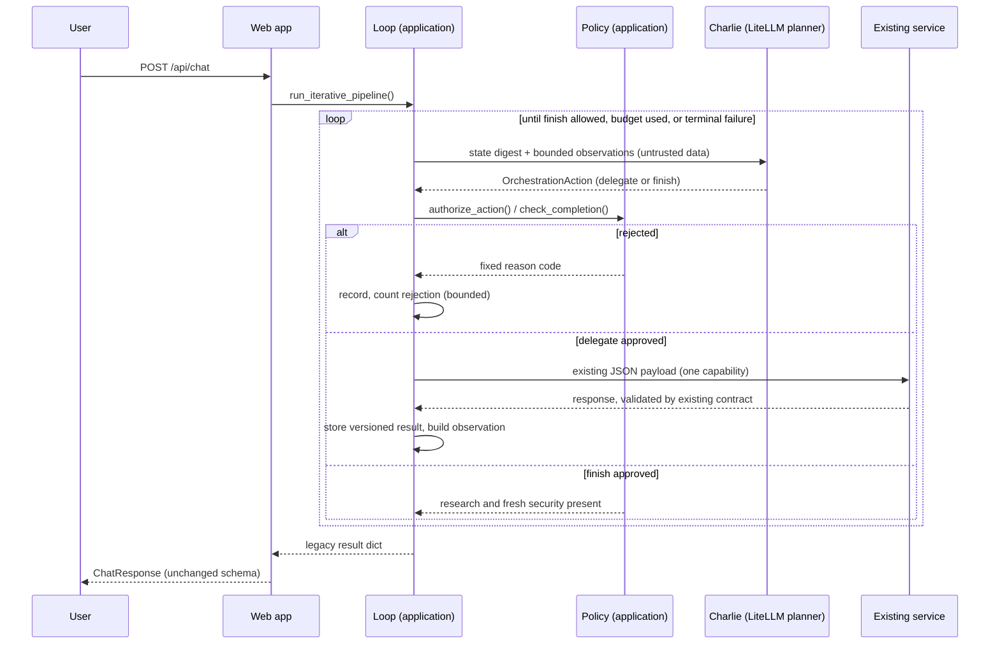
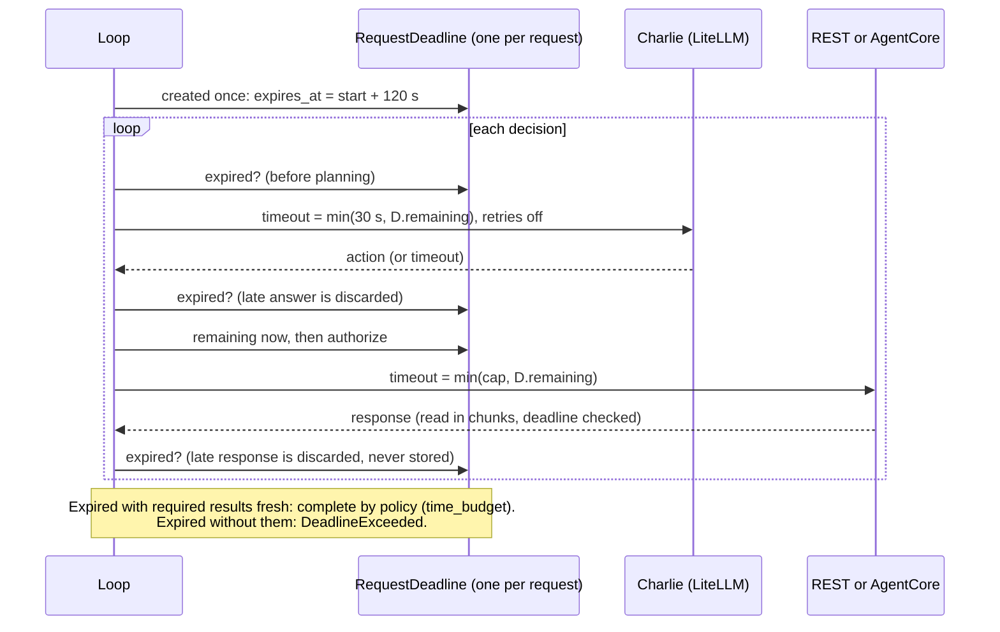

# Iterative orchestration

Phase 6 lets Charlie Chatwin coordinate a request over several decisions instead of choosing one workflow up front. After each approved step he sees a bounded summary of the result and decides what to do next. It is **off by default**, and with the flags off the earlier paths run unchanged.

## Controlled orchestration versus unrestricted autonomy

| Implemented here | Not implemented |
|---|---|
| One action per decision, from a fixed set of six capabilities | Tools, shell, new capabilities, new services |
| The application authorizes every action | Any model output being treated as permission |
| An explicit bounded loop with budgets | Recursion, retries, background work, parallel execution |
| Existing services, bindings and contracts | Changing payloads, endpoints or model aliases |
| Completion decided by application policy | The model declaring a task finished |

Charlie is the coordinator, and the application is the execution authority. Charlie's output is a proposal that policy accepts or rejects.

## Sequence



## Orchestration state

`OrchestrationState` exists for one request in memory only. It is never returned by any API and has no database. It holds:

- `request_id`, `original_question`, `current_goal`, `iteration` (executions started) and `decision_number`
- `completed_steps`: every validated execution as a `StepResult` with its version, the identity that ran it, the service, the duration, the validated envelope and result, and `based_on`, the input versions it used
- `pending_gaps`: up to 5 short unresolved questions Charlie noted
- `decision_history`: the last 32 content-free decision records (action, capability, status, reason code)
- `execution_budget`, `rejected_actions` and `status` (`running`, `completed`, `budget_exhausted`, `failed`)

A repeated capability adds a new version. Earlier versions are kept, so evidence is never silently overwritten. The final `PipelineState` takes the latest version of each capability, in the fixed pipeline order, so the response matches the fixed pipeline's shape.

## Action model

```python
class OrchestrationAction(BaseModel):   # frozen, unknown fields rejected
    action: Literal["delegate", "finish"]
    capability: one of the six implemented capabilities | None
    rationale: str            # 1-300 chars
    unresolved_question: str | None   # 1-200 chars
```

It is one flat model, which suits provider structured-output schemas better than a union. A validator requires a capability for `delegate`, and forbids a capability and an unresolved question for `finish`. There is no field for services, URLs, runtime identifiers, model aliases, tools, commands, credentials or permissions, and planned-only or unknown capability names cannot be expressed. The rationale and the unresolved question are never executed or logged. **The unresolved question is not sent to any service:** outbound payloads are unchanged, so it only informs Charlie's own state.

## Decision loop

Each pass of an explicit `while` loop does the following:

1. Stop if the deadline has passed or the decision budget is used up (see "Request deadline" and "Completion policy").
2. If the execution budget is used up and the required results are fresh, run **one final evaluation** in which only `finish` is accepted. If they are not fresh, there is nothing left to do and the run ends.
3. Ask Charlie for one action: one stateless LiteLLM call through `build_agent()` with the `CHARLIE_PLANNER_MODEL` alias, a timeout of `min(configured, time remaining)`, and client retries disabled.
4. Check the deadline again. A planner answer that arrives late is discarded, and a late `finish` is never recorded as Charlie's approval.
5. For `finish`, check completion policy. For `delegate`, check `authorize_action()` with the time remaining **now**, not the value from before planning.
6. If rejected, record it, give Charlie a fixed application notice, and count it. The second rejection ends the loop.
7. If approved, run exactly one capability through `invoke_agent()` with the deadline, which is the same call-and-validate boundary the fixed pipeline uses. A response that arrives after the deadline is discarded and never stored.

There is no recursion and no parallelism. The loop is bounded because every pass uses a decision and decisions are capped.

## Request deadline

`run_iterative_pipeline()` creates one `RequestDeadline` per request: `started = clock()`, `expires_at = started + budget.max_seconds`, using `time.monotonic` (a fake clock in tests). It is frozen, never reset and never given back to an individual agent as a fresh budget. A deadline has passed when the time remaining is zero or less. No operation starts after that, and `require_remaining()` raises `DeadlineExceeded`, a `TimeoutError` subclass that stays distinct from `PlannerInferenceError`, `AgentPipelineError`, `ActionRejected` and `OrchestrationFailed`.



### Propagation

| Operation | Bound | After the call |
|---|---|---|
| Charlie (planner) | `min(configured 30 s, remaining)`, no minimum, calculated just before the call; `max_retries=0` | Late result discarded |
| REST service call | `min(90 s cap, remaining)` | Checked on arrival and between 8 KB body chunks; late result discarded |
| AgentCore call | A per-request client with connect and read timeouts equal to the time remaining and `total_max_attempts=1` (no SDK retries) | Checked after the invocation and between body chunks |

Senders that declare a `deadline` keyword receive it (the default REST sender and AgentCore). Existing four-argument send callbacks keep working. The loop still checks the deadline around them, so a late result from any sender is discarded, but it cannot shorten a call it cannot see. A socket or SDK timeout is reported as `DeadlineExceeded` only if the deadline has actually expired. A timeout with time to spare stays an ordinary failure.

### Cooperative enforcement, not guaranteed cancellation

This is **cooperative deadline enforcement**. It is not a guarantee of end-to-end cancellation:

- Socket and SDK timeouts apply to each connect or read, not to the whole exchange. A slow-dripping response or a stalled connection can overrun the deadline by up to one operation's timeout. Chunked reads narrow this but cannot interrupt a blocked read.
- A timeout means this coordinator **stops waiting**. It does not stop a service, a remote AgentCore runtime, or a model call that LiteLLM or the provider has already started, and that work may still run and be billed.
- LiteLLM's OpenAI client retries twice by default. With a 0.4 s timeout against a local server that never answered, a call took 3.3 s with defaults and 0.7 s with `max_retries=0`, so the planner disables client retries.
- Strands can make a second model call when a model does not use the structured-output tool, and each call is bounded separately, so one planning decision can take up to about twice its timeout.
- AgentCore clients are created per call because botocore timeouts cannot be set per call. Client setup time is charged to the deadline, but the configured timeout is the time remaining at creation.
- Strict wall-clock bounds would need worker threads that abandon in-flight work, which this phase does not do.

## Capability dependencies

| Capability | Identity → service | Requires |
|---|---|---|
| research | Nova → research | nothing |
| fact_check | Scout → fact-check | research |
| source_quality | Scout → source-quality | research |
| security_assessment | Cipher → security | research |
| privacy_review | Cipher → privacy-review | research, security |
| synthesis | Charlie → synthesis | research, security |

`authorize_action()` also requires an enabled binding for the capability, a registered identity that declares it, an implemented capability, a configured service, and remaining repeat, execution and time budget. Outbound payloads are built by the existing legacy builders, and the context keys are always in the fixed pipeline's order, so payloads match the fixed pipeline's bytes whatever order Charlie chooses. Each run records the input versions it used. If research is re-run, anything built on the old version is stale.

## Evidence freshness

Every result records the input versions it used. A result is **fresh** if each of those inputs is still the latest version. A required input that is missing or newer makes it stale, and so does a fresh optional input at a different version than the one consumed, including one that appeared after the result ran (strict mode). A stale optional input is ignored when judging a newer result, because it was correctly left out.

- **Authorization** rejects with `dependency_stale` when a required input is stale. Privacy review and synthesis cannot run on a security assessment built on older research.
- **Payloads** include optional inputs only while fresh. Required inputs are always the latest. This differs from the fixed pipeline only in stale situations.
- **Completion** needs research and a security assessment based on the latest research.
- **The final response** includes only fresh results. A stale optional result is left out and nothing replaces it. Nothing is rerun or fabricated. `agent_activity` still lists everything that ran, and the state keeps every version.
- **Charlie** sees stale results marked in his digest and can refresh them.

## Observations

After each execution Charlie sees an `Observation` derived only from the validated result: capability, identity, status, duration, a summary of at most 600 characters, up to 5 evidence gaps of at most 200 characters, and a stale flag. One serialized observation is capped at 2,000 characters. Observations report what the agent returned. They never claim external verification. They appear in the **user message** under an "untrusted data" label and never in the system prompt. Full results stay in the state.

## Execution budgets

| Budget | Default | Ceiling |
|---|---|---|
| Decisions | 8 | 16 |
| Delegated executions | 6 | 12 |
| Repeats per capability (beyond the first run) | 2 | 3 |
| Total duration | 120 s | 300 s |
| Rejected actions | 2 | n/a |

The deadline above enforces the duration budget. The first four can be set with `VIHARBOT_ORCH_MAX_DECISIONS`, `_MAX_EXECUTIONS`, `_MAX_REPEATS` and `_MAX_SECONDS`, and are clamped to the ceilings. Model confidence is not an input anywhere. Every blocking call is bounded by the time remaining and late results are rejected, but the bound is cooperative (see the limits above), so the worst case can overrun by up to one operation's timeout. No platform request timeout is configured in this repository and the browser `fetch` has no abort timeout, so check your platform's limit before enabling this.

## Completion policy

Finishing needs research and a security assessment based on the latest research. Optional results may be absent, and nothing is fabricated. Each ending has a **reason** and a **kind**, kept in internal state and logs only:

| Kind | Meaning | Reasons |
|---|---|---|
| `charlie_approved` | Charlie asked to finish, on time, and policy agreed | `charlie_finished` |
| `policy_budget` | A limit was reached and the application completed with the fresh required results | `decision_budget`, `execution_budget`, `time_budget`, `rejection_limit` |
| `incomplete` | The run ended without the required results | the same limit reasons, or a failure |

| Situation | Behavior |
|---|---|
| Finish with required results fresh | `charlie_approved` |
| Premature finish (`mandatory_missing`) or stale security (`security_stale`) | Rejected and counted; Charlie is told |
| Execution budget used up, required results fresh, decisions and time left | Charlie gets **one final evaluation**; only `finish` is accepted. If he finishes: `charlie_approved`. Anything else is refused and the application completes by policy (`execution_budget`) |
| Decision budget used up, time budget used up, or rejection limit reached, with fresh required results | Completed by policy; never recorded as Charlie's decision |
| The same limits without the required results | Failure. Time expiry raises `DeadlineExceeded`; other limits raise `OrchestrationFailed`. Both return the existing sanitized 502 |
| A late `finish`, planner answer or service response after the deadline | Discarded, and completed by policy or failed as above |
| An agent call fails or returns a malformed response | Terminal: the existing 502 with agent activity |
| The planner fails, or returns invalid output | Terminal controlled failure, as in Phase 5 |

The final evaluation never exceeds the decision budget or the deadline, and no capability can run after the execution budget is spent. When the decision budget is also spent there is no evaluation, and the reason is `decision_budget`. The public response is the same for every ending.

## Feature flags

`VIHARBOT_ITERATIVE_ORCHESTRATION_ENABLED` (default false) also requires `VIHARBOT_DELEGATION_ENABLED` and `VIHARBOT_IDENTITY_ROUTING_ENABLED`. If either is off, iterative mode stays inactive and the Phase 5, Phase 3 or legacy path runs. `CHARLIE_PLANNER_MODEL` and `VIHARBOT_PLANNER_TIMEOUT_SECONDS` are reused. Personality-aware inference stays on its own flags. None of these is set in `compose.yaml`, `.env.example` or the DigitalOcean spec. As in Phase 5, the **web service needs LiteLLM credentials** for planning, and Phase 6 changes no deployment configuration.

## Public API and activity

`/api/chat` schemas, authentication, request ID handling and 502 handling are unchanged, and the response contains no orchestration fields. Repeated executions appear as repeated entries in `agent_activity`. The UI shows the research summary as the answer when no synthesis was run.

## Observability

`orchestrator` logs add `iteration`, `decision_number`, `requested_action`, `action_status`, `capability`, `identity_id`, `service_name`, `model_alias`, `execution_duration_ms`, `remaining_budget`, `elapsed_ms`, `remaining_ms`, `completion_status` (the kind), `completion_reason`, `stale_excluded` (results left out of the final response) and `error` (the error type or rejection code). `action_status` separates `recommended`, `authorized`, `rejected`, `executed`, `completed` and `failed`. `executed` is logged only after a validated, on-time response arrives, and `completed` only when the loop ends. Questions, rationales, observations and prompts are never logged.

## Security boundaries

Every action is validated by the application: unknown capabilities, disabled bindings, unavailable services, unmet dependencies and budget violations are rejected. A user cannot supply endpoints, models, identities or capabilities. Agent output is untrusted: it is bounded, labelled and kept out of the system prompt, and it cannot widen what policy authorizes. At worst, injected text wastes a decision or prompts an early `finish` that policy rejects. Charlie has no tools, shell or AWS access. His prompt was corrected where Phase 6 made it inaccurate: it now says he recommends the next capability and the application decides whether it runs, and it no longer says orchestration is unavailable.

## Limitations

- Outbound payloads are unchanged, so repeating a capability gives another model sample on the same input unless upstream results changed. Sending refined questions to services needs a versioned payload and is not implemented.
- Cost and latency rise: up to 8 planner calls plus up to 6 service calls per request.
- Which steps ran is visible in logs and `agent_activity` but there is no field for the decision history.
- Deadline enforcement is cooperative: a single blocked operation can overrun it, and a timeout does not cancel remote work (see above).
- Persona and decision quality are not measured; tests use a mocked planner.
- Only the six implemented capabilities can be delegated. Charlie cannot request a new capability, parallel work or a different model.
