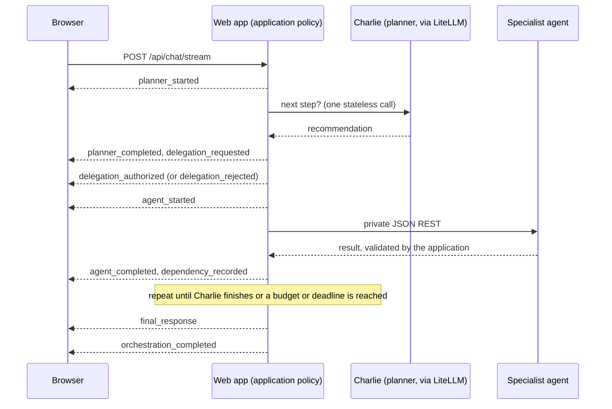

# Live orchestration events (`POST /api/chat/stream`)

**Status:** implemented (Phase 6.4, PR #11) and on `main`. **This is the canonical streaming protocol reference.** The normative schema lives in code: [`src/viharbot/live_events.py`](../src/viharbot/live_events.py) (event models, `EVENT_TYPES`, `check_stream`) and [`src/viharbot/live_stream.py`](../src/viharbot/live_stream.py) (emitter, SSE framing, transport). Other documents link here instead of restating the schema. `tests/test_docs_consistency.py` checks that the registry and every JSON example below match the code.

The endpoint reports what the iterative orchestration actually does, as it does it. It is plain server-sent events (SSE) from the existing web container. There is no broker, WebSocket, extra model call or progress estimate. Every event is emitted at a real boundary in the decision loop.

It exists only for **iterative** orchestration. If that mode is off the route answers `409` before streaming, and the browser falls back to `POST /api/chat`, whose request and response contracts are unchanged. See [iterative orchestration](iterative-orchestration.md) for the modes and flags.



Agents never message each other. Every handoff passes through the application.

## Endpoint contract

| Item | Behavior | Source |
|---|---|---|
| Request | The existing `ChatRequest` (`message`, optional `history`), unchanged | `chat_models.py` |
| Authentication | Same HTTP Basic dependency as `/api/chat` (`require_web_access`) when `WEB_AUTH_ENABLED` is on; `/health` is the only open route | `web_app.py:268` |
| Before streaming | `401` bad credentials, `422` invalid body, `409` iterative mode off (`Live streaming requires iterative orchestration`), `429` more than 8 concurrent streams | `web_app.py:257-281`, `live_stream.py:45` |
| Success status | `200`, then every later problem is an event, not a status code | `web_app.py:301` |
| Headers | `Content-Type: text/event-stream; charset=utf-8`, `Cache-Control: no-cache`, `X-Accel-Buffering: no`, `X-Request-ID` | `web_app.py:301-307` |
| Request ID | `X-Request-ID` is honored when well formed, otherwise a UUID is generated; every event repeats it | `web_app.py:275` |
| Concurrency cap | 8 simultaneous streams per process (`MAX_CONCURRENT_STREAMS`) | `live_stream.py:45` |

## SSE framing (as implemented)

Each event is one frame, UTF-8 encoded (`format_sse`, `live_stream.py:282`):

```text
id: evt-000001
event: planner_started
data: {"schema_version":"1.0", ... single-line JSON ...}

```

* `id:` is the `event_id` (`evt-` plus the zero-padded sequence) and `event:` is the `event_type`. The JSON line is the full event.
* A `: keep-alive` comment frame is sent after 15 seconds without an event (`KEEPALIVE_SECONDS`). It is a comment, not an event; clients ignore it.
* There is **no `retry:` directive** and no `Last-Event-ID` resume. A dropped stream is not replayed; reconnecting means a new request.
* Event names are the snake_case registry names below (for example `planner_started`), not dotted names.
* The producer queue is bounded (256) and the web side waits at most 10 seconds for a slow reader before it closes the run.

## Common envelope

Every event, without exception, has this envelope (`_Envelope`, `live_events.py:106`). Unknown fields are rejected by the models (`extra="forbid"`).

| Field | Type | Meaning |
|---|---|---|
| `schema_version` | `"1.0"` | Contract version. Clients reject anything else. |
| `event_id` | string | `evt-NNNNNN`, equal to the sequence |
| `request_id` | string | Same value on every event of the request and in `X-Request-ID` |
| `sequence` | integer | Starts at 1, increases by exactly 1 per event within a request |
| `timestamp` | string | ISO-8601 UTC, millisecond precision, `Z` suffix |
| `source` | object | `identity_id`, `display_name`, `role` (`orchestrator`, `specialist` or `application`) |
| `correlation` | object | `decision_number`, `execution_id`, `parent_event_id` (each may be `null`); a parent always has a lower sequence |
| `event_type` | string | One of the 14 names below |
| `data` | object | Typed per event |

`Result` references inside `data` (`ResultRef`) carry `identity_id`, `capability`, `result_version`; dependency references (`DependencyRef`) add `dependency_type`. Errors carry only a fixed `error_code` (and, for the terminal failure, a fixed `message`); no exception text, prompt or URL is ever included.

## Event registry

Exactly 14 events exist (`EVENT_TYPES`, `live_events.py:342`). "Required" and "optional" are the fields of `data`; the envelope above is always present.

| Event type | Required `data` fields | Optional `data` fields | Producer | Source role | Terminal |
|---|---|---|---|---|---|
| `planner_started` | `status`, `remaining_budget_ms` | none | Loop (`iterative_execution.py`) | Charlie / orchestrator | no |
| `planner_completed` | `status`, `duration_ms`, `action`, `capability` | `rationale`, `model_alias` | Loop | Charlie / orchestrator | no |
| `planner_failed` | `status`, `error_code`, `duration_ms` | none | Loop | Charlie / orchestrator | no |
| `delegation_requested` | `status`, `capability`, `target_identity` | none | Loop | Charlie / orchestrator | no |
| `delegation_authorized` | `status`, `capability`, `target_identity`, `service`, `result_version` | none | Loop, after `authorize_action()` | application | no |
| `delegation_rejected` | `status`, `capability`, `rejection_code` | none | Loop, after policy refusal or a late planner answer | application | no |
| `agent_started` | `status`, `capability`, `service`, `result_version` | none | Loop, just before the REST call | the executing specialist | no |
| `agent_completed` | `status`, `capability`, `result_version`, `duration_ms`, `validated` | `model_alias` | Loop, after the response validated | the executing specialist | no |
| `agent_failed` | `status`, `capability`, `error_code`, `duration_ms` | none | Loop, after a failed or invalid call | the executing specialist | no |
| `dependency_recorded` | `consumer`, `dependencies` | none | Loop, after `agent_completed` (omitted when no dependencies) | the executing specialist | no |
| `evidence_superseded` | `capability`, `superseded_version`, `replacement_version`, `affected_results` | none | Loop, when a repeat makes older results stale | application | no |
| `final_response` | `response` | none | Stream layer (`drive()`), not the loop | application | no |
| `orchestration_completed` | `status`, `completion_kind`, `completion_reason`, `decisions`, `executions`, `elapsed_ms` | none | Stream layer | application | **yes** |
| `orchestration_failed` | `status`, `error_code`, `message`, `elapsed_ms` | none | Stream layer | application | **yes** |

Notes:

* `planner_completed.model_alias` and `rationale`, and `agent_completed.model_alias`, are present only when `VIHARBOT_DEV_DIAGNOSTICS_ENABLED` is on. `model_alias` is the configured planner alias, or the alias the specialist itself reported in its response.
* `agent_completed.validated` is always `true`: an agent is reported complete only after its response passed the existing contract validation.
* The terminal events are `orchestration_completed` and `orchestration_failed`. `final_response` is **not** terminal; it always precedes `orchestration_completed`.

### Error and reason codes

`planner_failed.error_code`: `planner_unavailable`, `planner_inference_failed`, `planner_output_invalid`, `deadline_exceeded`. `agent_failed.error_code`: `agent_execution_failed`, `agent_response_invalid`, `deadline_exceeded`. `orchestration_failed.error_code`: `planner_unavailable`, `planner_inference_failed`, `planner_output_invalid`, `agent_execution_failed`, `agent_response_invalid`, `deadline_exceeded`, `orchestration_incomplete`, `internal_error` (the code `cancelled` is defined and has a message, but is never emitted; see the audit). `delegation_rejected.rejection_code` is one of 16 fixed codes defined as `RejectionCode` in `live_events.py` (for example `dependency_unmet`, `repeat_limit`, `execution_budget`, `deadline_exceeded`).

## JSON examples

Every example below is a real event taken from the run fixtures in `tests/fixtures/live_events/` and validates against the schema (`parse_event`). `final_response.data.response` is the same `ChatResponse` as `/api/chat`, with optional fields omitted when unset.

### `planner_started`

```json
{
  "schema_version": "1.0",
  "event_id": "evt-000001",
  "request_id": "req-123",
  "sequence": 1,
  "timestamp": "2026-10-27T19:00:00.000Z",
  "source": {
    "identity_id": "charlie",
    "display_name": "Charlie Chatwin",
    "role": "orchestrator"
  },
  "correlation": {
    "decision_number": 1,
    "execution_id": null,
    "parent_event_id": null
  },
  "event_type": "planner_started",
  "data": {
    "status": "running",
    "remaining_budget_ms": 119999
  }
}
```

### `planner_completed`

```json
{
  "schema_version": "1.0",
  "event_id": "evt-000015",
  "request_id": "req-123",
  "sequence": 15,
  "timestamp": "2026-10-27T19:00:03.500Z",
  "source": {
    "identity_id": "charlie",
    "display_name": "Charlie Chatwin",
    "role": "orchestrator"
  },
  "correlation": {
    "decision_number": 3,
    "execution_id": null,
    "parent_event_id": "evt-000014"
  },
  "event_type": "planner_completed",
  "data": {
    "status": "completed",
    "duration_ms": 4065.0,
    "action": "finish",
    "capability": null,
    "rationale": "The evidence is sufficient."
  }
}
```

### `planner_failed`

```json
{
  "schema_version": "1.0",
  "event_id": "evt-000008",
  "request_id": "req-126",
  "sequence": 8,
  "timestamp": "2026-10-27T19:00:01.750Z",
  "source": {
    "identity_id": "charlie",
    "display_name": "Charlie Chatwin",
    "role": "orchestrator"
  },
  "correlation": {
    "decision_number": 2,
    "execution_id": null,
    "parent_event_id": "evt-000007"
  },
  "event_type": "planner_failed",
  "data": {
    "status": "failed",
    "error_code": "planner_inference_failed",
    "duration_ms": 2588.0
  }
}
```

### `delegation_requested`

```json
{
  "schema_version": "1.0",
  "event_id": "evt-000003",
  "request_id": "req-123",
  "sequence": 3,
  "timestamp": "2026-10-27T19:00:00.500Z",
  "source": {
    "identity_id": "charlie",
    "display_name": "Charlie Chatwin",
    "role": "orchestrator"
  },
  "correlation": {
    "decision_number": 1,
    "execution_id": null,
    "parent_event_id": "evt-000002"
  },
  "event_type": "delegation_requested",
  "data": {
    "status": "requested",
    "capability": "research",
    "target_identity": "nova"
  }
}
```

### `delegation_authorized`

```json
{
  "schema_version": "1.0",
  "event_id": "evt-000004",
  "request_id": "req-123",
  "sequence": 4,
  "timestamp": "2026-10-27T19:00:00.750Z",
  "source": {
    "identity_id": "application",
    "display_name": "ViharBot",
    "role": "application"
  },
  "correlation": {
    "decision_number": 1,
    "execution_id": "exec-1",
    "parent_event_id": "evt-000003"
  },
  "event_type": "delegation_authorized",
  "data": {
    "status": "authorized",
    "capability": "research",
    "target_identity": "nova",
    "service": "research",
    "result_version": 1
  }
}
```

### `delegation_rejected`

```json
{
  "schema_version": "1.0",
  "event_id": "evt-000004",
  "request_id": "req-124",
  "sequence": 4,
  "timestamp": "2026-10-27T19:00:00.750Z",
  "source": {
    "identity_id": "application",
    "display_name": "ViharBot",
    "role": "application"
  },
  "correlation": {
    "decision_number": 1,
    "execution_id": null,
    "parent_event_id": "evt-000003"
  },
  "event_type": "delegation_rejected",
  "data": {
    "status": "rejected",
    "capability": "security_assessment",
    "rejection_code": "dependency_unmet"
  }
}
```

### `agent_started`

```json
{
  "schema_version": "1.0",
  "event_id": "evt-000005",
  "request_id": "req-123",
  "sequence": 5,
  "timestamp": "2026-10-27T19:00:01.000Z",
  "source": {
    "identity_id": "nova",
    "display_name": "Nova",
    "role": "specialist"
  },
  "correlation": {
    "decision_number": 1,
    "execution_id": "exec-1",
    "parent_event_id": "evt-000004"
  },
  "event_type": "agent_started",
  "data": {
    "status": "running",
    "capability": "research",
    "service": "research",
    "result_version": 1
  }
}
```

### `agent_completed`

```json
{
  "schema_version": "1.0",
  "event_id": "evt-000012",
  "request_id": "req-123",
  "sequence": 12,
  "timestamp": "2026-10-27T19:00:02.750Z",
  "source": {
    "identity_id": "cipher",
    "display_name": "Cipher",
    "role": "specialist"
  },
  "correlation": {
    "decision_number": 2,
    "execution_id": "exec-2",
    "parent_event_id": "evt-000011"
  },
  "event_type": "agent_completed",
  "data": {
    "status": "completed",
    "capability": "security_assessment",
    "result_version": 1,
    "duration_ms": 3432.0,
    "validated": true,
    "model_alias": "m-sec"
  }
}
```

### `agent_failed`

```json
{
  "schema_version": "1.0",
  "event_id": "evt-000012",
  "request_id": "req-127",
  "sequence": 12,
  "timestamp": "2026-10-27T19:00:02.750Z",
  "source": {
    "identity_id": "cipher",
    "display_name": "Cipher",
    "role": "specialist"
  },
  "correlation": {
    "decision_number": 2,
    "execution_id": "exec-2",
    "parent_event_id": "evt-000011"
  },
  "event_type": "agent_failed",
  "data": {
    "status": "failed",
    "capability": "security_assessment",
    "error_code": "agent_response_invalid",
    "duration_ms": 3432.0
  }
}
```

### `dependency_recorded`

```json
{
  "schema_version": "1.0",
  "event_id": "evt-000013",
  "request_id": "req-123",
  "sequence": 13,
  "timestamp": "2026-10-27T19:00:03.000Z",
  "source": {
    "identity_id": "cipher",
    "display_name": "Cipher",
    "role": "specialist"
  },
  "correlation": {
    "decision_number": 2,
    "execution_id": "exec-2",
    "parent_event_id": "evt-000012"
  },
  "event_type": "dependency_recorded",
  "data": {
    "consumer": {
      "identity_id": "cipher",
      "capability": "security_assessment",
      "result_version": 1
    },
    "dependencies": [
      {
        "identity_id": "nova",
        "capability": "research",
        "result_version": 1,
        "dependency_type": "required"
      }
    ]
  }
}
```

### `evidence_superseded`

```json
{
  "schema_version": "1.0",
  "event_id": "evt-000020",
  "request_id": "req-125",
  "sequence": 20,
  "timestamp": "2026-10-27T19:00:04.750Z",
  "source": {
    "identity_id": "application",
    "display_name": "ViharBot",
    "role": "application"
  },
  "correlation": {
    "decision_number": 3,
    "execution_id": "exec-3",
    "parent_event_id": "evt-000019"
  },
  "event_type": "evidence_superseded",
  "data": {
    "capability": "research",
    "superseded_version": 1,
    "replacement_version": 2,
    "affected_results": [
      {
        "identity_id": "cipher",
        "capability": "security_assessment",
        "result_version": 1
      }
    ]
  }
}
```

### `final_response`

```json
{
  "schema_version": "1.0",
  "event_id": "evt-000016",
  "request_id": "req-123",
  "sequence": 16,
  "timestamp": "2026-10-27T19:00:03.750Z",
  "source": {
    "identity_id": "application",
    "display_name": "ViharBot",
    "role": "application"
  },
  "correlation": {
    "decision_number": null,
    "execution_id": null,
    "parent_event_id": "evt-000015"
  },
  "event_type": "final_response",
  "data": {
    "response": {
      "request_id": "req-123",
      "findings": {
        "summary": "research-v1",
        "findings": [
          {
            "claim": "c",
            "evidence": "e",
            "confidence": "high"
          }
        ],
        "sources": [
          "src"
        ],
        "uncertainties": [
          "u"
        ]
      },
      "assessment": {
        "overall_risk": "low",
        "implications": [
          "i"
        ],
        "recommendations": [
          "r"
        ],
        "uncertainties": [
          "u"
        ]
      },
      "fact_check": null,
      "source_quality": null,
      "privacy_review": null,
      "synthesis": null,
      "agent_activity": [
        {
          "agent": "research",
          "display_name": "Research",
          "model_alias": "m-r",
          "duration_ms": 4276.0,
          "status": "complete"
        },
        {
          "agent": "security",
          "display_name": "Security",
          "model_alias": "m-sec",
          "duration_ms": 4487.0,
          "status": "complete"
        }
      ],
      "orchestration": {
        "mode": "iterative",
        "status": "completed",
        "completion_kind": "charlie_approved",
        "completion_reason": "charlie_finished",
        "decisions": 3,
        "executions": 2,
        "rejected_actions": 0,
        "elapsed_ms": 12400.0,
        "steps": [
          {
            "sequence": 1,
            "identity": "nova",
            "capability": "research",
            "service": "research",
            "version": 1,
            "status": "complete",
            "duration_ms": 4276.0,
            "in_final_result": true
          },
          {
            "sequence": 2,
            "identity": "cipher",
            "capability": "security_assessment",
            "service": "security",
            "version": 1,
            "status": "complete",
            "duration_ms": 4487.0,
            "in_final_result": true
          }
        ]
      }
    }
  }
}
```

### `orchestration_completed`

```json
{
  "schema_version": "1.0",
  "event_id": "evt-000017",
  "request_id": "req-123",
  "sequence": 17,
  "timestamp": "2026-10-27T19:00:04.000Z",
  "source": {
    "identity_id": "application",
    "display_name": "ViharBot",
    "role": "application"
  },
  "correlation": {
    "decision_number": null,
    "execution_id": null,
    "parent_event_id": "evt-000016"
  },
  "event_type": "orchestration_completed",
  "data": {
    "status": "completed",
    "completion_kind": "charlie_approved",
    "completion_reason": "charlie_finished",
    "decisions": 3,
    "executions": 2,
    "elapsed_ms": 13050.0
  }
}
```

### `orchestration_failed`

```json
{
  "schema_version": "1.0",
  "event_id": "evt-000009",
  "request_id": "req-126",
  "sequence": 9,
  "timestamp": "2026-10-27T19:00:02.000Z",
  "source": {
    "identity_id": "application",
    "display_name": "ViharBot",
    "role": "application"
  },
  "correlation": {
    "decision_number": null,
    "execution_id": null,
    "parent_event_id": "evt-000008"
  },
  "event_type": "orchestration_failed",
  "data": {
    "status": "failed",
    "error_code": "planner_inference_failed",
    "message": "Charlie's planning call did not complete.",
    "elapsed_ms": 7850.0
  }
}
```

## Lifecycles

Sequences are derived from the loop (`src/viharbot/iterative_execution.py`) and the stream layer (`live_stream.py:265`), and the first three are fixtures.

| Scenario | Events after the last successful step | Terminal |
|---|---|---|
| **Success** (fixture A) | `planner_started`, `planner_completed` (finish), `final_response` | `orchestration_completed`, `completion_kind=charlie_approved` |
| **Agent failure** (fixture E) | `agent_started`, `agent_failed` | `orchestration_failed` with the agent's code, no `final_response` |
| **Planner failure** (fixture D) | `planner_started`, `planner_failed` | `orchestration_failed` with the planner code, no `final_response` |
| **Dependency or policy rejection** (fixture B) | `planner_completed`, `delegation_requested`, `delegation_rejected` (for example `dependency_unmet`); the run continues with a new decision | Normal completion. After 2 refused actions (`rejection_limit`) the application completes under `policy_budget` if the required results are fresh, otherwise `orchestration_failed` (`orchestration_incomplete`) |
| **Deadline expiry** | `planner_failed` or `delegation_rejected` (`deadline_exceeded`); the application then completes only if the required Research and fresh Security results exist | `orchestration_completed` with `completion_kind=policy_budget`, `completion_reason=time_budget`; otherwise `orchestration_failed` (`deadline_exceeded`) |
| **Execution or decision budget exhausted** | Charlie gets one final evaluation turn when the execution budget is used up; no further delegation is authorized | `orchestration_completed` with `policy_budget` if the required results are fresh, else `orchestration_failed` (`orchestration_incomplete`) |
| **Client disconnect** | The stream generator is cancelled, `CancelToken` is set, and the loop starts no new delegation | **None** (nobody is listening) |

## Ordering and terminal guarantees

* **Server ordering.** Sequence numbers and `parent_event_id` are assigned by a per-request `EventEmitter`, with no global counters. The emitter refuses to emit `final_response` twice, `orchestration_completed` before `final_response`, or `orchestration_failed` after `final_response` (`EventContractError`). `check_stream` verifies a recorded stream against these invariants and is used in the tests.
* **Exactly one terminal event for a connected client**, under normal conditions: `drive()` (`live_stream.py:265`) turns every outcome into either `final_response` + `orchestration_completed` or a single `orchestration_failed`.
* **Client ordering.** The page (`static/index.html`, `checkEvent`) rejects an event that has an unknown schema version, an unknown type, a mismatched `id`/`event` pair, a different request ID, a sequence that is not exactly the previous plus one, an event after a terminal event, a completion without a final response, a failure after a final response, or two final responses. Any of these stops the stream and shows "Connection interrupted. Completion could not be verified." Events therefore cannot be silently reordered on screen.

### What is not guaranteed

* **No terminal event after the connection is lost.** A disconnect, proxy cut-off, process crash or restart ends the stream without one. The page treats a stream that ends without a terminal event as unverified, never as success.
* **A cancelled run emits no terminal event** by design.
* **A contract bug ends the stream cleanly but without a terminal event.** If emitting a terminal event itself raised `EventContractError`, the worker records `contract_error`, signals the end of the queue, and the stream closes (`event_stream`, `live_stream.py:309`). No test exercises this path; it is a reliability risk, not an observed failure.
* **Cancellation is cooperative.** The loop checks the token before each decision and after planning. A planner or agent call already in flight is not interrupted; it runs to its own timeout, and its result is discarded. A browser disconnect therefore does not stop remote inference.

## Client guidance

Read the response body incrementally, split on blank lines, ignore lines that start with `:`, parse the `data:` JSON, and validate it as the page does (above). Treat `final_response` followed by `orchestration_completed` as success, and `orchestration_failed` as failure. Render all text with `textContent`; the answer may use the page's small Markdown renderer, which creates no links, images or HTML. If the endpoint answers `409`, call `/api/chat` instead.

The page shows the model next to each speaker only when the event carries a `model_alias`; otherwise no model is claimed. The wording of each chat line is templated by the page from the recorded events; it is not generated by the agents' models.

## Versioning

`schema_version` is `"1.0"`. The models forbid unknown fields, and the page rejects any other version, so a change to a field or event requires a new version and a client update together. Adding an optional field is a schema change and goes through the same step. Do not add events without updating `EVENT_TYPES`, this document and the fixtures; `tests/test_docs_consistency.py` fails if the registry here drifts from the code.

## Security and privacy

* Same authentication as `/api/chat`; no new port, dependency or credential.
* Charlie only recommends. The application authorizes each delegation, and a refusal is shown as the application's decision.
* Events carry no API key, Authorization header, prompt, hidden reasoning, URL, hostname or exception text. Planner `rationale` and model aliases appear only with `VIHARBOT_DEV_DIAGNOSTICS_ENABLED`, which defaults to `false`. Note that model aliases are also present in `agent_activity` of the final `ChatResponse`.
* Logs record `agent`, `request_id`, duration, `action_status` (the terminal event name, or `no_terminal_event`) and error type; never event bodies.
* Limits: one web process, in-memory per-request state, no resumability, no persistence, no per-user authorization.

## Developer diagnostics

`VIHARBOT_DEV_DIAGNOSTICS_ENABLED` (default `false`) adds `rationale` and `model_alias` as described above. Token usage and cost are not reported by the services, and the Developer Metrics tab says so rather than estimating.

## Local validation

Tests are offline: `pytest` (see [development status](development-status.md) for the exact commands and known environment limits). To watch it live, set the three coordination flags and `CHARLIE_PLANNER_MODEL` as described in [iterative orchestration](iterative-orchestration.md), run `docker compose up -d --build`, and open <http://127.0.0.1:8080>. A real run makes billable LiteLLM calls.
