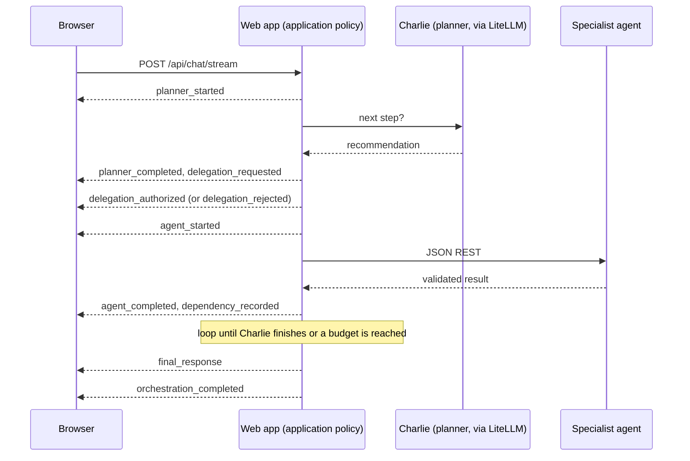

# Live orchestration and observability (Phase 6.4)

`POST /api/chat/stream` streams what the iterative orchestration actually does, as it does it. It is
plain server-sent events (SSE) over the existing web container. There is no broker, WebSocket, queue
service or extra model call. Every event is emitted at a real boundary in the decision loop; nothing is
simulated, estimated or inferred for display.

It requires iterative orchestration. Otherwise the route answers `409` before streaming and the browser
falls back to `POST /api/chat`, whose request and response contracts are unchanged.



Agents never message each other. Every handoff passes through the application.

## SSE contract

* Request body is the existing `ChatRequest`. Authentication is the same as `/api/chat`.
  Validation (`422`), authentication (`401`), unsupported mode (`409`) and the concurrency cap (`429`,
  at most 8 simultaneous streams) are normal HTTP errors returned before any streaming starts.
* Each frame is `id: <event_id>`, `event: <event_type>`, one single-line `data:` JSON object, blank line.
* A `: keep-alive` comment is sent every 15 seconds while idle. Clients ignore comments.
* Headers: `Content-Type: text/event-stream; charset=utf-8`, `Cache-Control: no-cache`,
  `X-Accel-Buffering: no`, and `X-Request-ID`.
* Events carry `schema_version` `"1.0"`, a per-request `sequence` starting at 1, `event_id` `evt-NNNNNN`
  (matching the sequence), an ISO-8601 UTC `timestamp`, a `source` (identity, display name, role),
  a `correlation` (`decision_number`, `execution_id`, `parent_event_id`) and a typed `data` object.
  `parent_event_id` always refers to an earlier event.

### Terminal guarantees

* Success: exactly one `final_response` (the same `ChatResponse` as `/api/chat`) followed by exactly one
  `orchestration_completed`. No `orchestration_failed`.
* Failure: exactly one `orchestration_failed` with a fixed code and message. No `final_response`.
* Nothing is sent after a terminal event. The browser treats a stream that ends without a terminal event, or
  with events out of order, for another request, or unknown, as unverified, and shows
  "Connection interrupted. Completion could not be verified." It never presents that as success.

## Event registry

| Event | Emitted when | Key data |
| --- | --- | --- |
| `planner_started` | Charlie's planning call begins | `remaining_budget_ms` |
| `planner_completed` | Planning returned a valid action | `duration_ms`, `action`, `capability` (+ `rationale`, `model_alias` in Dev diagnostics) |
| `planner_failed` | Planning failed or returned an invalid action | `duration_ms`, `error_code` |
| `delegation_requested` | Charlie named a capability | `capability`, `target_identity` |
| `delegation_authorized` | Application policy approved it | `capability`, `target_identity`, `result_version` |
| `delegation_rejected` | Application policy refused it | `capability`, `rejection_code` |
| `agent_started` | The specialist call begins | `capability`, `service`, `result_version` |
| `agent_completed` | Its response validated | `capability`, `result_version`, `duration_ms` (+ `model_alias` in Dev diagnostics) |
| `agent_failed` | The call or validation failed | `capability`, `duration_ms`, `error_code` |
| `dependency_recorded` | A result consumed earlier results (omitted when none) | `consumer`, `dependencies[]` |
| `evidence_superseded` | A newer result replaced one others relied on | `capability`, `superseded_version`, `replacement_version`, `affected_results[]` |
| `final_response` | The validated public response is ready | `response` (exactly `ChatResponse`) |
| `orchestration_completed` | The run finished | `completion_kind`, `completion_reason`, `decisions`, `executions`, `elapsed_ms` |
| `orchestration_failed` | The run failed | `error_code`, `message`, `elapsed_ms` |

Example frames:

```
id: evt-000001
event: planner_started
data: {"schema_version":"1.0","event_id":"evt-000001","request_id":"req-123","sequence":1,"timestamp":"2026-10-27T19:00:00.000Z","source":{"identity_id":"charlie","display_name":"Charlie Chatwin","role":"orchestrator"},"correlation":{"decision_number":1,"execution_id":null,"parent_event_id":null},"event_type":"planner_started","data":{"status":"running","remaining_budget_ms":119999}}

```

Real-run fixtures for every event type are in `tests/fixtures/live_events/` (successful request, with
diagnostics, policy rejection, evidence supersession, planner failure, agent failure). They are generated
from the production loop with mocked inference and checked by the tests.

## Disconnects and cancellation

When the client disconnects, the server sets a cancellation token and stops sending. The loop checks the
token before planning, before each delegation and between steps, so no new delegation starts after the
disconnect. This is cooperative: a model or agent call already in flight is not interrupted and finishes
or times out on its own. Events are not replayed; a reconnecting client starts a new request.

## Developer diagnostics

`VIHARBOT_DEV_DIAGNOSTICS_ENABLED` (default `false`) adds the planner's short `rationale` and model
aliases to `planner_completed` and `agent_completed`. Leave it off outside local Dev. Even when on, the
stream never contains API keys, Authorization headers, raw prompts, hidden reasoning, URLs or hostnames.
The Developer Metrics tab shows token usage or cost only when a service reports it; today it states
"not reported by the services".

## Browser behavior

While running, a live panel adds one row per event (portrait, name, what happened, duration). After the
answer, three tabs show the same recorded data: Execution Timeline, Agent Interactions and Developer
Metrics. All text is inserted with `textContent`; the final answer uses a small Markdown renderer
(headings, paragraphs, lists, tables, quotes, code, emphasis) that produces no links, images or HTML.
Animation respects `prefers-reduced-motion`.

## Security boundaries

* Same authentication as `/api/chat`; no new public ports; no new dependencies.
* Charlie only recommends. The application authorizes every delegation; a refusal is shown as the
  application's decision.
* Logs keep the existing structured fields and never include prompts, secrets or event bodies.
* Limits: a single web process, in-memory per-request state, no resumability, no persistence.

## Local Dev validation

Tests are offline (`pytest`). To see it live, set the three coordination flags and `CHARLIE_PLANNER_MODEL`
as described in `docs/iterative-orchestration.md`, optionally `VIHARBOT_DEV_DIAGNOSTICS_ENABLED=true`, run
`docker compose up -d --build`, and open http://localhost:8080. Real inference is billable and needs the
LiteLLM key; do it only deliberately.
