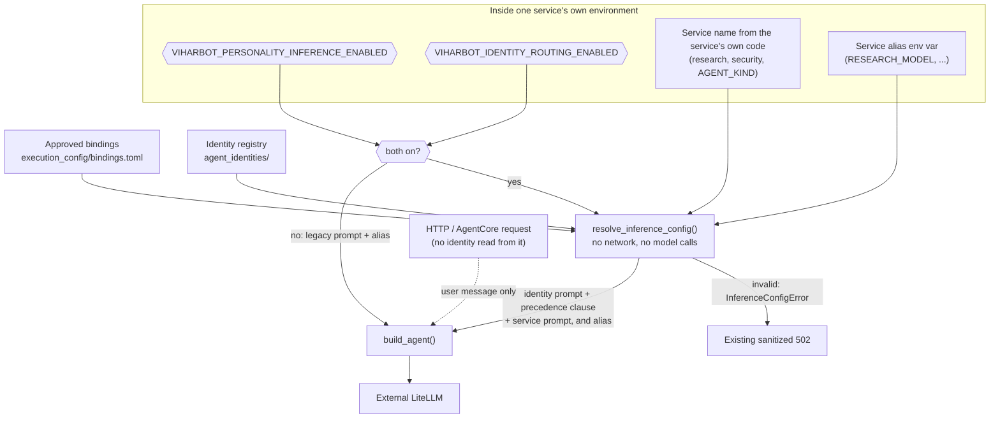

# Personality-aware inference

Phase 4 lets an operational service run its model call with the system prompt of the identity bound to it, instead of only its own prompt. It is **off by default**, and with the flags off every service behaves exactly as before.

## Attribution versus personality-aware inference

| | Phase 3: identity attribution | Phase 4: personality-aware inference |
|---|---|---|
| What it does | The orchestrator records which identity a step is attributed to | The service builds its model call with that identity's prompt |
| Affects the model call | No | Yes (the system prompt) |
| Where it lives | Orchestrator, internal records | Inside each service |

Personality mode is not delegation. No agent chooses another agent, plans, or calls tools. Each service still does the one job it did before, with a different system prompt.

## How it works

## Trust boundary

Nothing about identity is sent to a service. A service decides for itself, using only:

- its own name, which is fixed in its code
- the repository-controlled bindings and identity files shipped in its image
- its own two environment flags and its own alias variable

A request cannot choose, add or change an identity. Headers such as `X-Identity-ID` and body fields such as `identity_id` are never read. Because the decision is local, the same code runs for REST and for AgentCore `/invocations`, and no new protocol or authentication is needed. The orchestrator's flag does not reach the services, so each service's flags are set independently in that service's environment.

## Feature flags

| `VIHARBOT_PERSONALITY_INFERENCE_ENABLED` | `VIHARBOT_IDENTITY_ROUTING_ENABLED` | Result in a service |
|---|---|---|
| false / unset | any | Legacy prompt and alias |
| true | false / unset | Legacy prompt and alias (personality cannot activate without routing) |
| true | true | Personality-aware inference |

Both accept `1`, `true` or `yes`, are read on every request and default to false. Neither is set in `compose.yaml`, the DigitalOcean spec or `.env.example`, so deployed containers stay on legacy behavior until you change their configuration.

## Effective configuration

For a service such as `research`, resolution checks, in order:

1. The service name maps to a known implemented capability.
2. An approved, **enabled** binding exists for it and names this service.
3. The bound identity is registered and declares the capability.
4. The capability instructions are non-empty.
5. A model alias is available (see below) and is valid.

`ResolvedInferenceConfig` carries `identity_id`, `capability`, `service_name`, `model_alias` and the composed `system_prompt`. Resolution builds no Strands agent and makes no network calls. It is not exposed through any endpoint.

| Service | Identity | Capability |
|---|---|---|
| `research` | Nova | research |
| `fact-check`, `source-quality` | Scout | fact_check, source_quality |
| `security`, `privacy-review` | Cipher | security_assessment, privacy_review |
| `synthesis` | Charlie | synthesis |

Atlas, Pixel, Sage and Orbit have no bindings, so they can never run.

## Prompt composition

The effective system prompt is always, in this order:

1. The identity prompt from `agent_identities/prompts/<id>.md`.
2. A fixed clause saying the task instructions below take precedence over the persona.
3. The service's existing system prompt, verbatim.

Step 3 is the capability-specific instructions. It keeps each service's evidence rules, the rule to treat supplied text as untrusted, and Privacy Review's processing disclosure. The composition is deterministic. The user's message is never part of the system prompt; it stays in the existing user-message path. Prompts are never logged.

## Model alias precedence

1. The identity's own `model_alias` in its repository TOML, if set. All eight are unset today.
2. The service's existing variable (`RESEARCH_MODEL`, `FACT_CHECK_MODEL`, `SOURCE_QUALITY_MODEL`, `SECURITY_MODEL`, `PRIVACY_MODEL`, `SYNTHESIS_MODEL`). Their meaning is unchanged.
3. Otherwise the call fails.

`preferred_model_family` is a description and is never used as an alias. There is no fallback model. **Today every identity alias is unset, so personality mode changes only the prompt, not the model.** To route an identity to a different model, set its `model_alias` in its TOML after confirming that alias exists in your LiteLLM, and have the change reviewed. A configured alias is not verified to exist; LiteLLM reports an unknown alias when the call is made.

All inference still goes through the services' `build_agent()`, Strands and the external LiteLLM gateway.

## Failure behavior

If both flags are on and configuration is invalid, the service stops inside its existing error handling:

| Problem | Result |
|---|---|
| Unknown service, missing or disabled binding, unregistered identity, capability not declared or not implemented | `InferenceConfigError`, then the service's existing sanitized 502 |
| No alias, or an invalid alias | Same |
| Empty capability instructions | Same |

There is no switch to another identity, no fallback model and no invented alias. The response body is the existing generic message, for example `{"detail": "Research inference failed"}`. Logs carry the error type only, never prompts or alias values.

## Observability

Service logs for a personality-mode call add `identity_id`, `capability` and `personality_mode` to the existing fields (agent, request ID, model alias, duration, error). The identity logged is the one the service actually used. Legacy calls log exactly the same fields as before. The actual alias is also reported in the existing `requested_model_alias` response field.

The orchestrator's Phase 3 execution records are still planner attribution. They do not confirm what a service used, because the service response format has no identity field and was not changed. Confirming it would need an optional response field on the service endpoints, which is a contract change and has not been made.

## Compatibility

- `/api/chat`, its schemas and the agent endpoints are unchanged, and their OpenAPI schemas are identical to before.
- The structured output models are unchanged, and the six-stage order is unchanged.
- The legacy prompt texts are unchanged; tests compare them to hashes taken before this phase.
- No new services, endpoints, containers or dependencies.

## Limitations

- Prompt quality is not validated. Tests mock the model, so nothing here measures how a persona changes real output.
- Flags are per service, so services can disagree if configured differently.
- A failed personality call logs the legacy alias fields, with the error type identifying the cause.
- The identity prompts were written as declarative assets in Phase 2 and have not been tuned for use as live system prompts.
- Each identity has one prompt for all its capabilities. Scout and Cipher use the same persona prompt for two services.

## Future work (not implemented)

Choosing among identities, delegation between agents, planning, model fallback and tool permissions are all out of scope. They need their own designs, permission models and approval.
