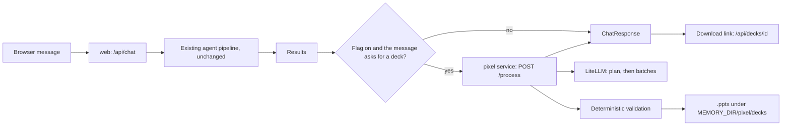

# Pixel slide service

> **Status: implemented for local Docker Compose (dev) and not yet run against a live model.** Everything here has only been exercised by a deterministic smoke build (`scripts/pixel_smoke.py`) and by reading the code. It is not in the DigitalOcean spec, so Stage does not run it. The layout and token design is in the [slide-generation spec](pixel-slide-generation-spec.md).

Pixel turns the team's results into a short slide deck as a `.pptx`. The model does the thinking (which slides, what each says, how to rate each item). Code does everything deterministic: fixed layouts and token schemas, validation between model calls, a hard call budget, and the file rendering.

## What changed in the identity rules

Pixel used to be a defined identity with no execution. These rules changed, and they are the only ones:

| Rule | Before | Now |
|---|---|---|
| Capabilities | `creative_design` (planned) | `creative_design` (still planned) and **`slide_generation` (implemented)** |
| Execution binding | none | `pixel` → `slide_generation` → service `pixel` in `execution_config/bindings.toml` |
| Operational services | six | seven: `pixel` fulfils `slide_generation` (`execution_bindings.OPERATIONAL_SERVICES`) |
| Model calls | none | the pixel service calls the LLM through LiteLLM with its own alias, `PIXEL_MODEL` |
| Prompt | persona plus a text slide style | persona only in `pixel.md`; task rules in `pixel/instructions.py`, composed like the other services |

Unchanged on purpose: Pixel still "cannot currently see, generate or edit images", still has "no tools beyond the text you are given", and a capability still grants no permission. The model gets no callable tools; code looks up layouts and frameworks and puts only what a call needs into its prompt. `tests/test_agent_identity.py` still pins those two statements.

## How it fits the Agent Constitution v1.0

- **2.2 / 2.3 Least and delegated authority.** Only an enabled repository binding authorizes the step (`pixel_authorized()`); a request cannot add or change it. The service can only read the results it is given and write a `.pptx`.
- **5.3 / 5.4 Delegation and communication.** Plain JSON REST, a validated `SpecialistResponse` envelope, and the request ID forwarded.
- **7.4 Prompt injection.** All supplied text, including other agents' output and the user's message, is marked untrusted in every prompt and in the task rules.
- **7.5 Tool execution.** No model-callable tools.
- **9.1 Centralized inference.** Every model call is `build_agent()` over LiteLLM; no provider SDK.
- **10.2 / 10.3 Budgets and waste.** At most `PIXEL_MAX_MODEL_CALLS` (default 8) model calls per deck, at most `PIXEL_TARGET_SLIDES` (default 6) slides planned, one retry per stage, and the whole feature behind the flag below.
- **3.1 Truthfulness, 11.1 Failure transparency.** Gaps are written `[to be supplied]`, capability claims are tagged `implemented` or `proposed`, compliance and certification phrasing is rejected, and a failed or partial deck is reported to the user, never hidden.
- **12.2 Amendments.** The Constitution itself is not amended. These are identity and binding changes, recorded here and in [identity execution integration](identity-execution-integration.md).

## The flag

`VIHARBOT_PPT_GENERATION_ENABLED` controls the whole feature. It is **true in local Compose for now**, to test Pixel's output, and both the web and pixel services read it.

| Environment | Value | Where it is set |
|---|---|---|
| Dev (local Compose) | **true** while the feature is tested | `compose.yaml` (`:-true` on `web` and `pixel`) and `.env.example` |
| Stage (DigitalOcean) | **false** | `deploy/digitalocean/app.yaml`, explicitly; the spec also has no pixel component |
| Production (AWS) | **true** | not configured anywhere yet: no production configuration exists in this repository, and AWS resources are created only when you explicitly ask. Set it when that configuration is written, together with a pixel runtime and an alias that your gateway routes. |

The code default is **false**, so any environment that doesn't set it never generates decks. When local testing is finished, set the Compose default to false. With the flag false the web service never calls Pixel and the pixel service answers `503`, so no model calls are spent on decks.

## Workflow



1. The pipeline runs exactly as before (the fixed pipeline, or the live team conversation when Charlie's planner is configured). The deck step is shared by `/api/chat` and the live stream (`/api/chat/stream`): on the stream it runs after the last agent and before `final_response`, which carries the `deck` object, and the stream sends keep-alive comments while it builds. If the client has already left, the deck step is skipped.
   **Pixel is in the team conversation.** On the stream the application authorizes Pixel because the user asked for a deck (`delegation_authorized`, source ViharBot, capability `slide_generation`), Pixel starts (`agent_started`), finishes or fails (`agent_completed` / `agent_failed`), and `dependency_recorded` lists the team results it read, with their real versions. No event says Charlie requested it, because the application, not his planner, started that step. This needed `pixel` added to the event `Service` literal and `slide_generation` to an event-only capability type; both are additive, and the loop's own capability set is unchanged, so a planner that names it is still refused.
2. If the flag is on and the user's message names a deck (`slide deck`, `slides`, `PowerPoint`, `pptx`, `presentation`), the web service checks Pixel's binding and calls the pixel service with the question and the team's results as named evidence. The trigger is a fixed pattern, not a model call.
3. The pixel service plans a manifest (one model call), then fills slides in batches of up to six (one call per batch), validating after each call. A failed manifest or batch is retried once with the error text; slides that still fail are left out and reported.
4. Code renders the `.pptx` from the layout registry and the validated payloads. Badges carry both a colour and a text label.
5. The chat response gains a `deck` object (status, slide count, `download_url`, warnings, rejected slides, never slide text), and an agent-activity row for Pixel. A Pixel failure never fails the chat; it appears in `deck`.

## Comparing models

The branding kit is shared by construction: colors, fonts, layouts and badge labels come from `design_tokens.json`, `layouts.json` and `render.py`, and the model only writes token text and badge ratings. To compare models, replay one saved evidence set through each alias and compare the decks:

```bash
# save a /api/chat response once, then:
docker cp chat.json <pixel-container>:/tmp/chat.json
docker compose exec -e VIHARBOT_PPT_GENERATION_ENABLED=true pixel \
  python -m viharbot.pixel.compare --evidence /tmp/chat.json --out /data/compare \
  gemini/gemini-3.5-flash openai/gpt-5.4-mini
docker cp <pixel-container>:/data/compare ./compare
```

It prints one row per model (slides kept and left out, gap and over-limit counts, model calls, seconds) and writes `deck-<alias>.pptx` for each. Add `--all-layouts` to force one slide per registered layout (24): code plans the slides, so the model is never asked which layouts to use and only fills them, in four batches. Pair it with `scripts/pixel_lorem_chat.json`, a valid `/api/chat` response written entirely in Lorem Ipsum, so the content is neutral and every layout gets filled with text of realistic length (the run asks for 8 to 12 words per token instead of "[to be supplied]"). That run is about layout fit and per-model compliance with the word limits, not content quality. Add `--creative` (with `--question "a short brief"`, and no `--evidence`) to see how freely each model can write. The model then gets only the brief, the layout catalog and the schemas, with no evidence, no framework list, no "use only the evidence" rule and no layout-fit guidance. The word limits, token schemas, compliance-phrase rejection and call budget still apply, because they keep the deck renderable and honest. Because the content is invented, code forces every slide to `proposed` and adds the warning "Illustrative content from a creative test run; it is not drawn from evidence." This mode exists only in the compare tool; the service and the chat workflow never use it, since inventing facts would break Constitution Section 3.1. Add `--repeat N` (1 to 10) to run each alias several times, since results vary between runs; each run writes its own deck and the table adds averages. Token counts come from the runs (Strands usage per call), and prices come from LiteLLM's read-only `/model/info` with the same key the agents already use, so cost needs no extra key or setup: cost = input tokens x input price + output tokens x output price, shown per run and per slide, or `n/a` if LiteLLM lists no price for an alias or reports no tokens. LiteLLM's spend endpoints returned 403 for that key, so they are not used. The model is chosen only here, never by a request. Each alias costs a few real model calls through LiteLLM, capped by `--max-calls`, and the tool refuses to run unless the PPT flag is true. A failing model is reported and the others still run.

## The HTML output page

Pixel is responsible for the deck's HTML page as well as the `.pptx`. `render_html()` in `src/viharbot/pixel/render.py` builds one self-contained page per deck from the same `design_tokens.json` and `layouts.json` that draw the slides, so the dark and light themes, accent colors, card structure and the badge colors and text labels (CRITICAL `#DC2626`, HIGH `#EA580C`, MEDIUM `#F59E0B`, LOW `#10B981`, NOT ASSESSED `#94A3B8`) match the PowerPoint exactly. Change a color in the token file and both formats change.

- The page has a sticky bar at the bottom with the slide count and the **Download the .pptx** link, plus any deck notes.
- The pixel service serves it at `/decks/<id>.html`, written beside the `.pptx` and pruned with it. The web service proxies it at `/api/decks/<id>/view`, behind the same login, and the chat reply **embeds it directly in the output** as a sandboxed frame (`sandbox="allow-downloads"`, so nothing runs but the page's own download link), with the **Download the .pptx** note below it at the bottom of the response. There is no separate View link.
- Every value is HTML-escaped, and the page uses only inline CSS: no scripts, images or external assets. It is served with `Content-Security-Policy: default-src 'none'; style-src 'unsafe-inline'`, so a hostile string in model output cannot execute.
- **The chat page output uses the same tokens.** The web service serves `viharbot.pixel.theme.tokens_css()` builds from `design_tokens.json` as `--px-*` CSS variables, which the web service inlines into the page when it serves `/` (the file stays self-contained: no external stylesheet, which a page test enforces) (light and dark theme colors, the AI and Zero Trust accents, and the status colors with their text colors). `static/index.html` restyles the response output with them: the answer card, labels, findings sections, activity rows, the deck note and the security and privacy risk labels, which are colored by level (LOW green, MEDIUM amber, HIGH orange) with the level still written as text. Fallbacks in the CSS keep the page readable if the variables are missing. The rest of the chat page (header, sidebar, background, fonts, the live panels) keeps its own palette, and `index.html` is still a hand-written file rather than something Pixel generates.

## Which model each agent uses

The sidebar and the Meet the team page show a model logo and alias next to every agent that has one, and the chat shows the model on each agent run and in the live conversation next to the speaker. The aliases are never typed into the page: every agent serves `GET /model` (its own configured alias, no inference, no key), and the web service gathers them at `/api/team-models`, grouped by identity through the approved execution bindings and cached for 30 seconds, so the display cannot drift from what the agents run. Charlie shows his synthesis model and, when configured, his planner. The logos are simple stand-in marks (`images/model-openai.svg`, `images/model-gemini.svg`), not the vendors' official artwork; drop official files with the same names into `images/` to replace them. An agent that is unreachable simply shows no model.

## Limitations

- Not run against a real model. The planner and generator prompts, structured-output behaviour and typical slide quality are unverified.
- Slide visuals are one generic grid per layout. Nobody has looked at the rendered slides. Overflow is handled by a deterministic fit step in `render.py` (it estimates each cell's text height from its size, margins and font sizes and lowers the font, to a floor of 8 pt, until it should fit), badges sit beside the text on short rows, and four layouts have a header band so their main cells get the full height. With the longest text allowed in every field of all 24 layouts, no cell is estimated to overflow (smallest font used 8.5 pt), but that is an estimate from character counts, not a real PowerPoint layout.
- Deck generation takes several model calls and can take minutes; the web call allows 300 seconds. Public platforms that cut requests off sooner would need an asynchronous design.
- Finished decks contain the team's results and live in the pixel container's `MEMORY_DIR` (a named volume locally, `/tmp` on App Platform). Only the newest 20 are kept (`PIXEL_MAX_DECKS`). Pixel's `POST /process` and deck downloads verify signed service assertions when `VIHARBOT_SERVICE_AUTH` is on (the default in local Compose, off on Stage); with it off, the pixel service trusts the private network like the other agents, and the web service is protected only by its web login.
- On the live stream, the panel shows nothing new while the deck builds (about 15 seconds on `openai/gpt-5.4-mini`, much longer on slower models) and the deck appears with the final answer.
- Deck detection is a keyword pattern, so a message that merely mentions a presentation can trigger a deck while the flag is on.
- `PIXEL_MODEL` defaults to `openai/gpt-5.4-mini` in Compose. A 3-run comparison on real evidence (2026-10-31) found it about one tenth the cost per deck and about nine times faster than `gemini/gemini-3.5-flash`, with the same gap rate and no slides left out: roughly $0.025 to $0.042 against $0.28 to $0.34 per deck. Gemini used about ten times more output tokens. Pixel's `preferred_model_family` is now "GPT mini family"; it is still only a description, and the alias comes from the service environment. Quality was judged by metrics only, not by a blind human review, and it is one evidence set.
- The Stage spec (`deploy/digitalocean/app.yaml`) deliberately has no pixel component; adding one is a cost change that needs your approval first.
